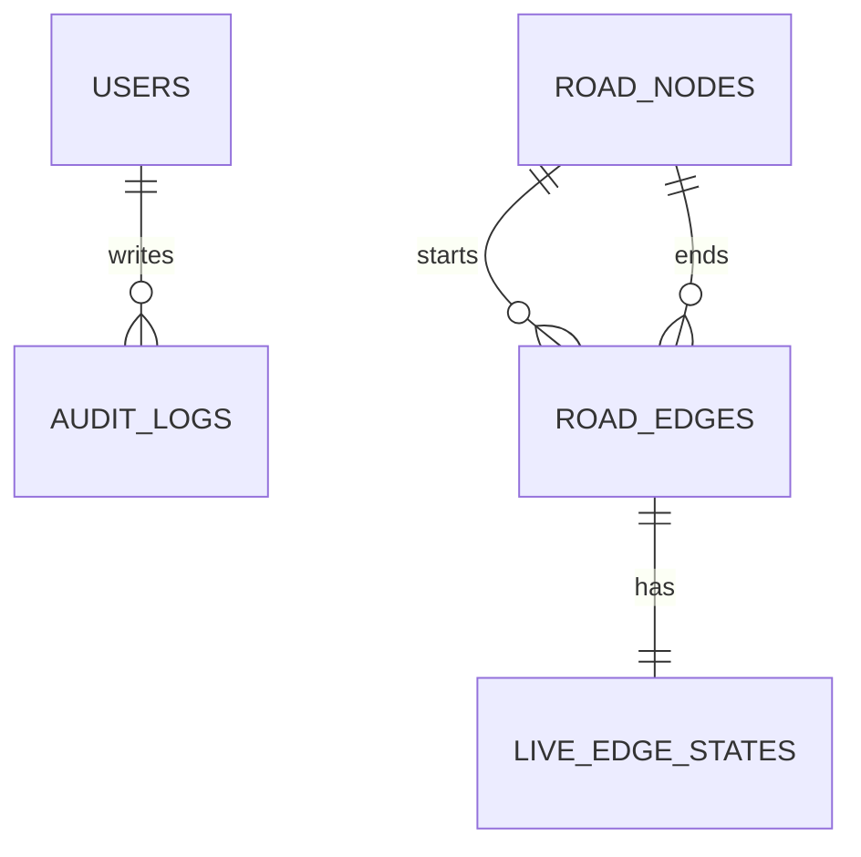

# TECHNICAL SPECIFICATION DOCUMENT (TSD)

## MetroFlow — Intelligent Urban Mobility and Flood Simulation System

Version 1.0

## Document Control

| Field       | Value                                 |
| ----------- | ------------------------------------- |
| Project     | MetroFlow                             |
| Document    | Technical Specification Document      |
| Version     | 1.0                                   |
| Prepared By | «Project Team»                        |
| Baseline    | `main` @ `9605e38` (last code commit) |

## Requirements Traceability

| BRD ID | FSD ID                               | Technical Component                          |
| ------ | ------------------------------------ | -------------------------------------------- |
| BR-001 | FSD-FR-001 to FSD-FR-005             | Network State Service, PostGIS geometry      |
| BR-002 | FSD-FR-006 to FSD-FR-010             | Hydrology Engine (SCS-CN), live state writer |
| BR-003 | FSD-FR-011 to FSD-FR-017             | Routing Engine (Time-Dependent A\*)          |
| BR-004 | FSD-FR-024 to FSD-FR-031             | Incident Queue (portal state)                |
| BR-005 | FSD-FR-026 to FSD-FR-028             | Queue filter and search                      |
| BR-006 | FSD-FR-032 to FSD-FR-038             | Incident Detail panel                        |
| BR-007 | FSD-FR-039 to FSD-FR-046             | Dispatch actions and operations log          |
| BR-008 | FSD-FR-043 to FSD-FR-047             | Audit log schema and migration               |
| BR-009 | FSD-FR-018 to FSD-FR-023, FSD-FR-048 | Access control (planned)                     |
| BR-010 | FSD-FR-050 to FSD-FR-052             | API runtime, security middleware, OpenAPI    |
| BR-011 | FSD-FR-023, FSD-FR-051               | Row-level security, TLS, header policy       |
| BR-012 | FSD-FR-049                           | Reporting and export (planned)               |

## 1. Solution Architecture

```text
                    rainfall input                      incident reports
                          │                                    │
                          ▼                                    ▼
              ┌───────────────────────┐            ┌───────────────────────┐
              │  Simulation engine    │            │  Dispatch portal      │
              │  SCS-CN → depth       │◄───────────│  queue · detail · log │
              │  TD-A*  → route       │  network   │  (mock data today)    │
              └───────────┬───────────┘  + routes  └───────────┬───────────┘
                          │                                    │
                          ▼                                    ▼
              ┌─────────────────────────────────────────────────────────┐
              │  PostgreSQL + PostGIS  (nodes · edges · live state)      │
              │  versioned by Alembic · row-level security on hosted DB  │
              └─────────────────────────────────────────────────────────┘
```

The API is stateless: every request loads its data from PostgreSQL, so
instances can be added horizontally. The portal is a Next.js App Router client
application; today it holds incident data locally, with a single module as the
seam for a future intake API.

**Design principles**

| Principle                           | Consequence                                                        |
| ----------------------------------- | ------------------------------------------------------------------ |
| One source of truth for passability | A single function classifies edges for both map colour and routing |
| Configuration over constants        | Calibration values are environment-driven, not literals            |
| Schema owned by migrations          | No `create_all` at runtime; drift fails CI                         |
| Fail closed at the edges            | Security scan and migration gates block rather than warn           |
| Honest boundaries                   | Mock data and unimplemented features are labelled, not implied     |

## Application Components

| Component             | BRD/FSD Reference                    | Responsibilities                                                           |
| --------------------- | ------------------------------------ | -------------------------------------------------------------------------- |
| Network State Service | BR-001 / FSD-FR-001 to 005           | Load graph, classify passability, emit GeoJSON nodes and edges             |
| Hydrology Engine      | BR-002 / FSD-FR-006 to 010           | SCS-CN runoff, elevation-weighted ponding, speed degradation, state commit |
| Routing Engine        | BR-003 / FSD-FR-011 to 017           | TD-A\* search, clearance blocking, route geometry assembly, travel time    |
| Geometry Service      | BR-001 / FSD-FR-004, FSD-FR-053      | Idempotent PostGIS backfill with advisory lock                             |
| Data Layer            | BR-001 / FSD-FR-001                  | SQLAlchemy models, connection lifecycle, migrations                        |
| Audit Store           | BR-008 / FSD-FR-047                  | Actor, action, JSON payload, integrity hash (schema only)                  |
| Dispatch Portal       | BR-004 to BR-007 / FSD-FR-018 to 046 | Login, queue, detail, operations log, dispatch actions                     |
| Security Middleware   | BR-011 / FSD-FR-051                  | Response headers on every request                                          |
| Delivery Pipeline     | BR-008 / FSD-FR-047                  | Lint, test, scan, migrate, publish image                                   |

### Technology stack

| Layer           | Technology                   | Version                   |
| --------------- | ---------------------------- | ------------------------- |
| API language    | Python                       | 3.14                      |
| API framework   | FastAPI                      | ≥ 0.143.5                 |
| ORM             | SQLAlchemy                   | ≥ 2.1.5                   |
| Spatial ORM     | GeoAlchemy2                  | ≥ 0.20.0                  |
| Migrations      | Alembic                      | ≥ 1.20.0                  |
| Database        | PostgreSQL + PostGIS         | 15 + 3.3 local; 17 hosted |
| Driver          | psycopg2-binary              | ≥ 2.9.13                  |
| Frontend        | Next.js (App Router)         | 16.4.2                    |
| UI runtime      | React                        | 19.3.1                    |
| Styling         | Tailwind CSS                 | 4.x                       |
| Package manager | Bun                          | 1.4.3                     |
| Tests           | pytest, ESLint, `next build` | see repository            |

## Database Design - road_nodes

| Column        | Type                  | Description                        |
| ------------- | --------------------- | ---------------------------------- |
| `node_id`     | integer               | Primary key                        |
| `name`        | varchar(100)          | Human label                        |
| `latitude`    | double                | WGS84 latitude                     |
| `longitude`   | double                | WGS84 longitude                    |
| `elevation_m` | double                | Default 10.0; drives ponding depth |
| `geom`        | geometry(Point, 4326) | Backfilled, never overwritten      |

Index: primary key plus GiST on `geom`.

## Database Design - road_edges

| Column            | Type                       | Description                    |
| ----------------- | -------------------------- | ------------------------------ |
| `edge_id`         | integer                    | Primary key                    |
| `start_node_id`   | integer                    | FK → `road_nodes.node_id`      |
| `end_node_id`     | integer                    | FK → `road_nodes.node_id`      |
| `distance_meters` | double                     | Traversal length               |
| `max_speed_kmh`   | double                     | Default 50                     |
| `lanes`           | integer                    | Default 2                      |
| `geom`            | geometry(LineString, 4326) | Backfilled from endpoint nodes |

Index: primary key plus GiST on `geom`.

## Database Design - live_edge_states

| Column            | Type      | Description                         |
| ----------------- | --------- | ----------------------------------- |
| `state_id`        | integer   | Primary key                         |
| `edge_id`         | integer   | Unique FK → `road_edges.edge_id`    |
| `water_depth_cm`  | double    | Current depth                       |
| `avg_speed_kmh`   | double    | Degraded by simulation              |
| `vehicle_density` | double    | Reserved                            |
| `is_override`     | boolean   | Manual overrides survive simulation |
| `updated_at`      | timestamp | Set on insert and update            |

## Database Design - users

| Column          | Type         | Description                                         |
| --------------- | ------------ | --------------------------------------------------- |
| `user_id`       | integer      | Primary key                                         |
| `name`          | varchar(100) | Display name                                        |
| `email`         | varchar(100) | Unique; login identifier                            |
| `password_hash` | varchar(255) | Hash, never plaintext                               |
| `role`          | varchar(20)  | `SUPER_ADMIN`, `LGU_DISPATCHER`, `EMERGENCY_DRIVER` |
| `created_at`    | timestamp    | Creation time                                       |

## Database Design - audit_logs

| Column           | Type      | Description                                |
| ---------------- | --------- | ------------------------------------------ |
| `log_id`         | integer   | Primary key                                |
| `user_id`        | integer   | FK → `users.user_id`                       |
| `action_type`    | varchar   | Dispatch, escalate, hold, reject, override |
| `payload`        | text      | JSON snapshot of the action                |
| `hash_signature` | varchar   | Integrity hash                             |
| `created_at`     | timestamp | Event time                                 |

## API Design

| Endpoint                   | Method | Reference                  |
| -------------------------- | ------ | -------------------------- |
| `/`                        | GET    | BR-010 / FSD-FR-050        |
| `/api/v1/network/state`    | GET    | BR-001 / FSD-FR-001 to 005 |
| `/api/v1/simulation/rain`  | POST   | BR-002 / FSD-FR-006 to 010 |
| `/api/v1/routing/navigate` | GET    | BR-003 / FSD-FR-011 to 017 |
| `/openapi.json`            | GET    | BR-010 / FSD-FR-052        |

Full request and response contracts, examples and error bodies are in
[api.md](api.md).

## Validations

| Validation ID | BRD Ref | FSD Ref    | Rule                                                          |
| ------------- | ------- | ---------- | ------------------------------------------------------------- |
| VAL-001       | BR-001  | FSD-FR-002 | `clearance_cm` must be greater than 0 and at most 200         |
| VAL-002       | BR-002  | FSD-FR-006 | `rainfall_mm_hr` is required and must be between 0 and 250    |
| VAL-003       | BR-003  | FSD-FR-011 | `start_node` is required and must be an integer               |
| VAL-004       | BR-003  | FSD-FR-011 | `target_node` is required and must be an integer              |
| VAL-005       | BR-003  | FSD-FR-015 | Both node ids must exist in the graph                         |
| VAL-006       | BR-003  | FSD-FR-012 | An edge is excluded when `water_depth_cm >= clearance_cm`     |
| VAL-007       | BR-001  | FSD-FR-003 | Passability boundaries are inclusive at caution and clearance |
| VAL-008       | BR-002  | FSD-FR-009 | Overridden edges are excluded from simulation writes          |
| VAL-009       | BR-009  | FSD-FR-018 | Username and password are required on the login form          |
| VAL-010       | BR-007  | FSD-FR-037 | An empty internal note is not submitted                       |
| VAL-011       | BR-005  | FSD-FR-026 | Filter values are constrained to the defined source set       |
| VAL-012       | BR-008  | FSD-FR-047 | Schema changes are applied only through Alembic revisions     |

## Security Design

| Security Requirement                                                                   | Reference                            |
| -------------------------------------------------------------------------------------- | ------------------------------------ |
| Response headers: nosniff, frame denial, referrer policy, cross-origin resource policy | BR-011 / FSD-FR-051                  |
| Row-level security on all application tables                                           | BR-011 / FSD-FR-047                  |
| `anon` and `authenticated` privileges revoked                                          | BR-011 / FSD-FR-051                  |
| TLS required for the hosted database connection                                        | BR-011 / FSD-FR-051                  |
| Secrets supplied only as environment variables or repository secrets                   | BR-011 / FSD-FR-051                  |
| Container runs as an unprivileged user                                                 | BR-011 / FSD-FR-051                  |
| Automated dependency updates (Dependabot)                                              | BR-008 / FSD-FR-047                  |
| Static analysis (CodeQL) with capability preflight                                     | BR-008 / FSD-FR-047                  |
| Dynamic API scan (OWASP ZAP), fail-closed                                              | BR-008 / FSD-FR-047                  |
| Authentication and role enforcement                                                    | BR-009 / FSD-FR-021 to 023 — planned |

**Open security risks**

| ID      | Risk                                         | Severity | Disposition                                                      |
| ------- | -------------------------------------------- | -------- | ---------------------------------------------------------------- |
| SEC-001 | API has no authentication or authorisation   | High     | Accepted for the pilot; BR-009 is the first post-pilot increment |
| SEC-002 | CORS allows every origin with credentials    | Medium   | Restrict to known portal origins before production               |
| SEC-003 | No rate limiting                             | Medium   | Add at the proxy or via middleware before public exposure        |
| SEC-004 | CodeQL cannot analyse the private repository | Medium   | Activates automatically when public or licensed                  |
| SEC-005 | Audit hash column has no write path          | Low      | Implement with FSD-FR-047                                        |

## Error Handling

| Error Code | Condition                                      | Action                                                       |
| ---------- | ---------------------------------------------- | ------------------------------------------------------------ |
| E001       | Unknown `start_node` or `target_node`          | Return 404 naming the available node ids                     |
| E002       | No route survives the clearance check          | Return 404 with a human-readable message                     |
| E003       | `clearance_cm` outside `(0, 200]`              | Return 422 with field-level detail                           |
| E004       | `rainfall_mm_hr` missing or outside `[0, 250]` | Return 422 with field-level detail                           |
| E005       | Required query parameter missing               | Return 422 listing the missing location                      |
| E006       | Database unreachable at startup                | Fail startup; container exits; health check never goes green |
| E007       | Unhandled server error                         | Return 500; log the traceback; do not leak internals         |

Transaction rules: read endpoints do not commit; simulation commits once after
all edge updates; migrations run one transaction per revision.

## Technical Test Cases

| TC ID   | BRD Ref | FSD Ref    | Scenario                                                         |
| ------- | ------- | ---------- | ---------------------------------------------------------------- |
| TTC-001 | BR-001  | FSD-FR-001 | Network state returns every seeded node and edge                 |
| TTC-002 | BR-001  | FSD-FR-003 | Passability thresholds hold at exact boundaries                  |
| TTC-003 | BR-002  | FSD-FR-007 | SCS-CN returns zero at zero rainfall and increases monotonically |
| TTC-004 | BR-002  | FSD-FR-008 | Lower elevation produces deeper ponding at equal runoff          |
| TTC-005 | BR-002  | FSD-FR-009 | Overridden edge is not modified by simulation                    |
| TTC-006 | BR-003  | FSD-FR-012 | A\* returns the optimal path on the seeded graph                 |
| TTC-007 | BR-003  | FSD-FR-014 | Blocked graph returns no path                                    |
| TTC-008 | BR-003  | FSD-FR-016 | Reverse route mirrors the forward route                          |
| TTC-009 | BR-008  | FSD-FR-047 | `alembic upgrade head` then `alembic check` reports no drift     |
| TTC-010 | BR-011  | FSD-FR-051 | `anon` role is denied access to application tables               |
| TTC-011 | BR-010  | FSD-FR-051 | Every response carries the four security headers                 |
| TTC-012 | BR-001  | FSD-FR-053 | Restarting the API does not duplicate seed rows                  |

## Technical Acceptance Criteria

| BRD Ref | FSD Ref           | Criteria                                                                  |
| ------- | ----------------- | ------------------------------------------------------------------------- |
| BR-001  | FSD-FR-001 to 005 | Every edge carries depth and status; invalid parameters rejected with 422 |
| BR-002  | FSD-FR-006 to 010 | Simulation persists depth and speed and returns the updated network       |
| BR-003  | FSD-FR-011 to 017 | Route segments are below clearance, or the API returns 404 with a reason  |
| BR-004  | FSD-FR-024 to 029 | Queue renders in urgency order with the required fields                   |
| BR-007  | FSD-FR-039 to 046 | Each action writes a timestamped, attributed log entry                    |
| BR-008  | FSD-FR-047        | Migrations apply cleanly and deny public database roles                   |
| BR-010  | FSD-FR-050 to 052 | Health endpoint, security headers and OpenAPI are reachable               |
| BR-011  | FSD-FR-051        | No secret in the repository; RLS verified against the `anon` role         |

## 2. Algorithms

### 2.1 SCS Curve Number runoff

```text
P  = rainfall_mm_hr × duration_hrs
S  = (25400 / CN) − 254
Ia = 0.2 × S
Q  = (P − Ia)² / (P − Ia + S)     if P > Ia, else 0
```

| Parameter      | Default | Meaning                           |
| -------------- | ------- | --------------------------------- |
| `CN`           | 85      | Urban concrete/asphalt catchment  |
| `duration_hrs` | 1.0     | Converts intensity to storm depth |
| `Ia`           | 0.2 S   | Initial abstraction               |

### 2.2 Ponding depth

```text
depression = 1 + (10 − min(elevation_m, 10)) × 0.15
depth_cm   = max(0, (Q / 10) × depression × amplification)
```

`amplification` defaults to 3.5 and represents depression storage and the
drainage-area ratio. It is configuration, not a physical constant, and must be
replaced by a DEM and drainage-network model before results are treated as
predictive.

### 2.3 Passability

```text
if depth >= clearance      → SUBMERGED
else if depth >= caution   → LIGHT_FLOOD
else                       → PASSABLE
```

Both comparisons are inclusive. `clearance` defaults to 30 cm; `caution` to 10 cm.
The same function feeds the map legend and the router's blocking rule.

### 2.4 Time-Dependent A\*

```text
penalty   = 1 + (depth_cm / 10)^1.8
speed_m_s = max((max_speed_kmh / 3.6) / penalty, 0.5)
cost      = length_m / speed_m_s            (seconds)
heuristic = haversine(node, target) / fastest_graph_speed
```

An edge is skipped entirely when `depth_cm >= clearance_cm`. The heuristic never
overestimates remaining time, so the result is optimal for this cost function.

| Structure        | Use                                                           |
| ---------------- | ------------------------------------------------------------- |
| `heapq` min-heap | Frontier; entries carry `g` so stale duplicates are discarded |
| `g_score` dict   | Best known cost per node                                      |
| `came_from` dict | Path reconstruction                                           |
| `settled` set    | Guarantees each node expands once                             |

Complexity: `O(E log V)` time, `O(V + E)` space. Each edge is added in both
directions, so a reverse trip never fails for lack of a directed edge.

### 2.5 Geometry assembly

For each hop, stored geometry is fetched and reversed when travel runs against
the stored direction. Consecutive hops are joined, dropping a duplicated vertex
at the seam. A straight line is used when geometry is missing.

## 3. Data Relationships and Migrations



| Revision       | Purpose                                                              |
| -------------- | -------------------------------------------------------------------- |
| `fd26e0cb82cc` | Initial schema: five application tables plus spatial columns         |
| `a1b2c3d4e5f6` | Enable RLS on application tables and revoke `anon` / `authenticated` |

Rules:

- Every schema change is a revision; `create_all` is never called at runtime.
- CI runs `alembic upgrade head` then `alembic check`; drift fails the build.
- Reflected foreign tables (PostGIS `spatial_ref_sys`, `tiger`, `topology`) are
  filtered out of autogenerate, so deleting a model needs a hand-written `DROP`.
- Downgrades are maintained so a revision can be reversed during development.

## 4. Configuration

Settings use the `METROFLOW_` prefix and may be supplied in a local `.env`.

| Variable                          | Default           | Effect                              |
| --------------------------------- | ----------------- | ----------------------------------- |
| `DATABASE_URL`                    | local PostGIS DSN | Connection string                   |
| `METROFLOW_CURVE_NUMBER`          | 85                | SCS-CN curve number                 |
| `METROFLOW_RAINFALL_DURATION_HRS` | 1.0               | Storm duration                      |
| `METROFLOW_PONDING_AMPLIFICATION` | 3.5               | Runoff-to-street-depth factor       |
| `METROFLOW_CAUTION_DEPTH_CM`      | 10.0              | Light-flood threshold               |
| `METROFLOW_DEFAULT_CLEARANCE_CM`  | 30.0              | Clearance when omitted              |
| `RUN_MIGRATIONS`                  | true              | Apply migrations on container start |

Repository secrets:

| Secret            | Required by                 | Status                                      |
| ----------------- | --------------------------- | ------------------------------------------- |
| `SUPABASE_DB_URL` | Supabase migration workflow | **Not set**; CD no-ops until it is supplied |

## 5. Deployment and CI/CD

### 5.1 Local stack

| Service    | Image / build                   | Port | Health check         |
| ---------- | ------------------------------- | ---- | -------------------- |
| `postgres` | `postgis/postgis:15-3.3-alpine` | 5432 | `pg_isready`         |
| `redis`    | `redis:7-alpine`                | 6379 | `redis-cli ping`     |
| `backend`  | built from `backend/Dockerfile` | 8000 | `curl /openapi.json` |

Redis is provisioned for future caching and pub/sub but is not used by the
application today. The container runs as uid 10001 and applies migrations on
start unless `RUN_MIGRATIONS=false`.

### 5.2 Hosted database

| Property     | Value                                                |
| ------------ | ---------------------------------------------------- |
| Provider     | Supabase                                             |
| Region       | `ap-northeast-2` (Seoul)                             |
| Engine       | PostgreSQL 17.11 with PostGIS                        |
| Connection   | Session pooler with `sslmode=require`                |
| Access model | API connects as owner; `anon`/`authenticated` denied |

The direct `db.<ref>.supabase.co` host is IPv6-only and unreachable from GitHub's
IPv4 runners, so the session pooler host is required.

### 5.3 Workflows

| Workflow                      | Trigger                                     | Gate                                                            |
| ----------------------------- | ------------------------------------------- | --------------------------------------------------------------- |
| Backend CI                    | Push/PR touching `backend/**`; manual       | Unit tests, contract tests, `alembic upgrade`, `alembic check`  |
| Web CI                        | Push/PR touching `web-lgu/**`; manual       | Bun install, ESLint, `next build`                               |
| Security — OWASP ZAP API Scan | Weekly cron and manual                      | Fails on findings at or above threshold; no `continue-on-error` |
| Security — CodeQL             | Push/PR to `main`, weekly, manual           | Skips with a visible warning when code scanning is unavailable  |
| Supabase — Apply migrations   | After Backend CI succeeds on `main`; manual | Serialised; no-ops without `SUPABASE_DB_URL`                    |
| Backend Image                 | Manual or `backend-v*` tag                  | Builds and pushes to GHCR; does not deploy                      |

Delivery flow:

```text
change ──► pull request ──► Backend CI ──┐
                       └──► Web CI     ──┴──► merge to main
                                              ├──► Backend CI ──► Supabase migrations
                                              └──► tag backend-v* ──► GHCR image
```

## 6. Architecture Decisions

| ID      | Decision                               | Alternatives considered             | Rationale                                                                | Status            |
| ------- | -------------------------------------- | ----------------------------------- | ------------------------------------------------------------------------ | ----------------- |
| ADR-001 | Alembic owns the schema                | `Base.metadata.create_all`          | `create_all` cannot alter existing tables, so the database would drift   | Accepted          |
| ADR-002 | Supabase as hosted Postgres            | Self-managed VM, RDS                | Managed PostGIS, free tier, pooler, point-in-time recovery on paid plans | Accepted          |
| ADR-003 | Session pooler for CI                  | Direct `db.<ref>` host              | The direct host is IPv6-only; GitHub runners are IPv4                    | Accepted          |
| ADR-004 | Time-dependent A\*                     | Dijkstra, contraction hierarchies   | Optimal routes with a smaller frontier under depth-dependent cost        | Accepted          |
| ADR-005 | SCS-CN for runoff                      | Rational method, hydrodynamic model | Standard, explainable, few parameters; adequate for a decision aid       | Accepted          |
| ADR-006 | Ponding amplification as configuration | Hard-coded coefficient              | Makes the calibration assumption explicit and tunable                    | Accepted          |
| ADR-007 | RLS deny-by-default on Supabase        | Rely on API auth only               | The Data API is publicly reachable with the anon key                     | Accepted          |
| ADR-008 | ZAP is a gate, not a report            | `continue-on-error`                 | A report nobody reads does not prevent regressions                       | Accepted          |
| ADR-009 | CodeQL preflight skip                  | Delete or let it fail               | Keeps the workflow ready to activate without edits                       | Accepted          |
| ADR-010 | Bun ecosystem in Dependabot            | npm ecosystem                       | Dependabot cannot parse `bun.lock` under npm                             | Accepted          |
| ADR-011 | Portal ships with mock incident data   | Block the UI until intake exists    | Demonstrates the workflow and fixes the visual contract early            | Accepted, interim |
| ADR-012 | Security headers in middleware         | Reverse proxy only                  | Headers exist even without a proxy, which is how ZAP sees the app        | Accepted          |
| ADR-013 | Redis provisioned but unused           | Remove it                           | Keeps parity with the intended production topology                       | Open              |

## 7. Known Limitations

| ID      | Limitation                                | Impact                                        | Planned resolution                        |
| ------- | ----------------------------------------- | --------------------------------------------- | ----------------------------------------- |
| LIM-001 | No authentication or authorisation        | Cannot handle real personal data; API is open | Implement identity and roles (BR-009)     |
| LIM-002 | Incident data is mocked                   | Triage is demonstrated, not operational       | Build intake and persistence              |
| LIM-003 | No live sensor or weather ingestion       | Simulation is operator-driven                 | Integrate feeds with agreements           |
| LIM-004 | Redis is unused                           | Extra container in the stack                  | Cache network state; pub/sub updates      |
| LIM-005 | CORS allows all origins with credentials  | Cross-origin abuse surface                    | Allowlist portal origins                  |
| LIM-006 | No rate limiting or WAF                   | DoS and credential-stuffing exposure          | Proxy-level rules before exposure         |
| LIM-007 | No map rendering in the portal            | GeoJSON served but not drawn                  | MapLibre component                        |
| LIM-008 | Audit log is schema-only                  | No immutable trail of decisions               | Implement FSD-FR-047 with hash chaining   |
| LIM-009 | No automated browser end-to-end tests     | UI regressions caught manually                | Add Playwright to Web CI                  |
| LIM-010 | CodeQL inactive on the private repository | Static analysis gap                           | Publish the repo or license Code Security |
| LIM-011 | Single-region hosted database             | Latency and availability risk                 | Choose a region near operations           |
| LIM-012 | No backup/restore runbook or DR test      | Recovery objectives unverified                | Define RPO/RTO and test restore           |
| LIM-013 | Deleting a model needs a manual `DROP`    | Migration authoring risk                      | Documented in migration rules             |
| LIM-014 | Seeded graph is four nodes                | Routing demonstration is narrow               | Import the real road network              |

## 8. Repository and Commands

```text
MetroFlow/
├── backend/                 FastAPI engine
│   ├── main.py              app, middleware, endpoints
│   ├── config.py            METROFLOW_* settings
│   ├── hydrology.py         SCS-CN and ponding
│   ├── routing.py           passability and TD-A*
│   ├── geometry.py          PostGIS backfill
│   ├── models.py            SQLAlchemy models
│   ├── schemas.py           response contracts
│   ├── migrations/          Alembic history
│   ├── tests/               unit and integration suites
│   ├── Dockerfile
│   └── entrypoint.sh
├── web-lgu/                 Next.js dispatch portal
├── docs/                    this document set
├── scripts/                 pre-commit helper
├── .github/workflows/       CI/CD
└── docker-compose.yml       local stack
```

| Task             | Command                                       |
| ---------------- | --------------------------------------------- |
| Start the stack  | `docker compose up --build`                   |
| Run the API      | `cd backend && uvicorn main:app --reload`     |
| Apply migrations | `cd backend && alembic upgrade head`          |
| Check drift      | `cd backend && alembic check`                 |
| Unit tests       | `cd backend && pytest -m "not integration"`   |
| Contract tests   | `cd backend && pytest -m integration`         |
| Run the portal   | `cd web-lgu && bun run dev`                   |
| Lint and build   | `cd web-lgu && bun run lint && bun run build` |
| Inspect contract | `curl http://localhost:8000/openapi.json`     |
