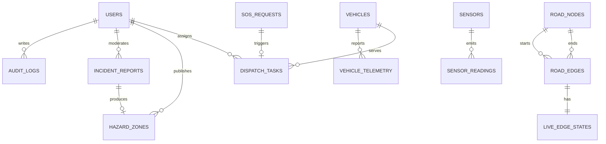

# TECHNICAL SPECIFICATION DOCUMENT (TSD)

## MetroFlow — Intelligent Urban Mobility and Flood Simulation System

Version 1.2

## Document Control

| Field       | Value                                                            |
| ----------- | ---------------------------------------------------------------- |
| Project     | MetroFlow                                                        |
| Document    | Technical Specification Document                                 |
| Version     | 1.2                                                              |
| Prepared By | «Project Team»                                                   |
| Baseline    | `main` @ `9605e38` (last code commit)                            |
| Change      | CR-001 adds the driver app, event stream, fleet, SOS and sensors |

Version 1.2 describes the **target architecture** for CR-001, including the
approved provider keys and API-issued session tokens. Sections marked `Planned` are not
implemented in the baseline. See [CR-001.md](CR-001.md) for the change record and
FSD §Implementation Status for the current position.

## Requirements Traceability

| BRD ID | FSD ID                               | Technical Component                                   |
| ------ | ------------------------------------ | ----------------------------------------------------- |
| BR-001 | FSD-FR-001 to FSD-FR-005             | Network State Service, PostGIS geometry               |
| BR-002 | FSD-FR-006 to FSD-FR-010             | Hydrology Engine (SCS-CN), live state writer          |
| BR-003 | FSD-FR-011 to FSD-FR-017             | Routing Engine (Time-Dependent A\*)                   |
| BR-004 | FSD-FR-024 to FSD-FR-031             | Incident Queue (portal state)                         |
| BR-005 | FSD-FR-026 to FSD-FR-028             | Queue filter and search                               |
| BR-006 | FSD-FR-032 to FSD-FR-038             | Incident Detail panel                                 |
| BR-007 | FSD-FR-039 to FSD-FR-046             | Dispatch actions and operations log                   |
| BR-008 | FSD-FR-043 to FSD-FR-047             | Audit log schema and migration                        |
| BR-009 | FSD-FR-018 to FSD-FR-023, FSD-FR-048 | Access control — API-issued JWT with role checks (CR-001) |
| BR-010 | FSD-FR-050 to FSD-FR-052             | API runtime, security middleware, OpenAPI             |
| BR-011 | FSD-FR-023, FSD-FR-051               | Row-level security, TLS, header policy                |
| BR-012 | FSD-FR-049                           | Reporting and export (planned)                        |
| BR-013 | FSD-FR-054 to FSD-FR-064             | Driver app, routing extensions, SSE client            |
| BR-014 | FSD-FR-065 to FSD-FR-081             | Report service, evidence store, moderation            |
| BR-015 | FSD-FR-073, 074, 087                 | SOS service and distress incidents                    |
| BR-016 | FSD-FR-075 to FSD-FR-089             | Map UI, fleet service, dispatch engine                |
| BR-017 | FSD-FR-090, FSD-FR-091               | Sensor service and impact rules                       |
| BR-018 | FSD-FR-059, 068 to 071               | Native offline cache, queue, sync                     |

## 1. Solution Architecture

```text
   driver app (metroflow-mobile, Expo)           LGU portal (metroflow-admin)
   nav · alerts · report · SOS                   map · moderation · draw · fleet
   SQLite cache · offline queue                  SSE client · dispatch
            │                                              │
            └────────────── HTTPS + SSE ──────────────────┘
                                   │
                     FastAPI  (session tokens · RBAC · rate limits)
        network · routing · simulation · reports · hazards
        vehicles · telemetry · SOS · dispatch · sensors
                     │                              │
        PostgreSQL + PostGIS                 Redis pub/sub
        graph · reports · hazards            events · throttle
        fleet · sensors · audit              counters · cache
                     │
              evidence volume (photos)
```

The API is stateless apart from the evidence volume and Redis: every request
loads its data from PostgreSQL, and events fan out through Redis, so instances
can be added horizontally. The portal is a Next.js App Router application; the
driver client is a native Expo app built with React Native and Expo Router. It is
distributed separately from the portal and uses native background tasks, SQLite
and SecureStore rather than browser storage.

The event path is deliberately narrow. A privileged mutation commits to
PostgreSQL, writes its audit record, publishes to a Redis channel, and returns;
the SSE endpoint relays the channel to connected clients. Publication latency is
measured from the commit to the emitted event, not from the device receiving it.

**Design principles**

| Principle                           | Consequence                                                           |
| ----------------------------------- | --------------------------------------------------------------------- |
| One source of truth for passability | A single function classifies edges for both map colour and routing    |
| Configuration over constants        | Calibration values are environment-driven, not literals               |
| Schema owned by migrations          | No `create_all` at runtime; drift fails CI                            |
| Fail closed at the edges            | Security scan and migration gates block rather than warn              |
| Honest boundaries                   | Mock data and unimplemented features are labelled, not implied        |
| One event bus                       | Hazard, fleet and SOS updates follow one publish path                 |
| Offline is a first-class state      | The driver app models pending, synced and stale, not online-only      |
| Evidence is untrusted input         | Photos are re-encoded, stripped and size-checked before storage       |
| Privilege is explicit               | Every mutating LGU route declares the roles allowed to call it        |
| Design is supplied, not invented    | Portal and driver UI follow the client HTML/CSS template, not new design |

## Application Components

| Component             | BRD/FSD Reference                    | Responsibilities                                                           |
| --------------------- | ------------------------------------ | -------------------------------------------------------------------------- |
| Network State Service | BR-001 / FSD-FR-001 to 005           | Load graph, classify passability, emit GeoJSON nodes and edges             |
| Hydrology Engine      | BR-002 / FSD-FR-006 to 010           | SCS-CN runoff, elevation-weighted ponding, speed degradation, state commit |
| Routing Engine        | BR-003 / FSD-FR-011 to 017           | TD-A\* search, clearance blocking, route geometry assembly, travel time    |
| Geometry Service      | BR-001 / FSD-FR-004, FSD-FR-053      | Idempotent PostGIS backfill with advisory lock                             |
| Data Layer            | BR-001 / FSD-FR-001                  | SQLAlchemy models, connection lifecycle, migrations                        |
| Audit Store           | BR-008 / FSD-FR-047                  | Actor, action, JSON payload, integrity hash (schema only)                  |
| Dispatch Portal       | BR-004 to BR-007 / FSD-FR-018 to 046 | Login, queue, detail, operations log, dispatch actions                     |
| Security Middleware   | BR-011 / FSD-FR-051                  | Response headers on every request                                          |
| Delivery Pipeline     | BR-008 / FSD-FR-047                  | Lint, test, scan, migrate, publish image                                   |
| Auth Service          | BR-009 / FSD-FR-092                  | Session token issue and verification, role dependency (audit context planned) |
| Report Service        | BR-014 / FSD-FR-065 to 081           | Multipart intake, EXIF extraction, urgency, dedupe, moderation             |
| Hazard Service        | BR-013 / FSD-FR-059 to 064, 082–086  | Polygon/line validation, obstruction level, publish and withdraw           |
| Event Stream          | BR-018 / FSD-FR-086                  | Redis pub/sub fan-out over SSE with reconnect snapshots                    |
| Fleet Service         | BR-016 / FSD-FR-075, 076, 088        | Unit registry, status transitions, telemetry, nearest-unit ranking         |
| Dispatch Service      | BR-016 / FSD-FR-087 to 089           | Distress incidents, assignment, flood-safe rescue route                    |
| Sensor Service        | BR-017 / FSD-FR-090, 091             | Reading validation, thresholds, impact radius, advisory roads              |
| Evidence Store        | BR-014 / FSD-FR-066, 067             | Local volume for the pilot; MIME check, re-encode, EXIF strip              |
| Driver app            | BR-013 to BR-018 / FSD-FR-054 to 074 | Navigation, alerts, reports, offline cache and SOS                         |
| LGU Map UI            | BR-016 / FSD-FR-075, 076, 082–089    | MapLibre layers, draw tools, fleet and dispatch panels                     |

### Technology stack

| Layer           | Technology                                    | Version                                    |
| --------------- | --------------------------------------------- | ------------------------------------------ |
| API language    | Python                                        | 3.14                                       |
| API framework   | FastAPI                                       | ≥ 0.143.5                                  |
| ORM             | SQLAlchemy                                    | ≥ 2.1.5                                    |
| Spatial ORM     | GeoAlchemy2                                   | ≥ 0.20.0                                   |
| Migrations      | Alembic                                       | ≥ 1.20.0                                   |
| Database        | PostgreSQL + PostGIS                          | 15 + 3.3 local; 17 hosted                  |
| Driver          | psycopg2-binary                               | ≥ 2.9.13                                   |
| Frontend        | Next.js (App Router)                          | 16.4.2                                     |
| Driver client   | Expo + React Native                           | Expo SDK 58, React Native 0.88, React 19.3 |
| Mobile tooling  | Expo Router, React Navigation, expo-location   | Current at implementation                  |
| Mapping         | react-native-maps (driver, in use); MapLibre GL JS (portal, CR-001 work) | Partial — the driver renders a native map; the portal draws no map yet (LIM-007) |
| UI runtime      | React (portal); React Native (driver)         | 19.3 / 0.88                                |
| Styling         | Tailwind CSS                                  | 4.x                                        |
| UI source       | Client-supplied HTML/CSS template             | Figma-derived; adapted to React components |
| Package manager | Bun                                           | 1.4.3                                      |
| Realtime        | SSE + Redis pub/sub                           | Redis 7                                    |
| Auth            | API-issued HS256 JWT; bcrypt password hashes  | PyJWT 2.15, passlib/bcrypt                 |
| Evidence        | Pillow, python-multipart                      | current at implementation                  |
| Tests           | pytest, Ruff, ESLint, `tsc --noEmit`, framework builds | In CI today; Playwright and `bun test` are planned (LIM-009) |

### External data services

| Service        | Mode              | Used for                        | Failure behaviour                                        |
| -------------- | ----------------- | ------------------------------- | -------------------------------------------------------- |
| Supabase (Postgres) | Runtime      | Hosted database                 | API unavailable; no fallback                             |
| Mapbox         | Planned (CR-001)  | Raster basemap                  | OpenStreetMap raster fallback; no client requests tiles today |
| OpenWeather    | Planned (CR-001)  | Rainfall intensity              | Manual rainfall override; the run is labelled as manual  |
| OpenTopography | Offline           | Digital elevation model         | Cached derived terrain; no runtime impact                |
| Copernicus     | Offline           | Sentinel imagery and land cover | Cached derived layers; no runtime impact                 |

Terrain and imagery are downloaded by a preprocessing step, not by the API. The
derived datasets carry provider attribution; raw products are not redistributed
from this repository.

## Database Design - road_nodes

| Column        | Type                  | Description                        |
| ------------- | --------------------- | ---------------------------------- |
| `node_id`     | integer               | Primary key                        |
| `name`        | varchar(100)          | Human label                        |
| `latitude`    | double                | WGS84 latitude                     |
| `longitude`   | double                | WGS84 longitude                    |
| `elevation_m` | double                | Default 10.0; drives ponding depth |
| `geom`        | geometry(Point, 4326) | Backfilled, never overwritten      |

Index: primary key plus GiST on `geom`.

## Database Design - road_edges

| Column            | Type                       | Description                    |
| ----------------- | -------------------------- | ------------------------------ |
| `edge_id`         | integer                    | Primary key                    |
| `start_node_id`   | integer                    | FK → `road_nodes.node_id`      |
| `end_node_id`     | integer                    | FK → `road_nodes.node_id`      |
| `distance_meters` | double                     | Traversal length               |
| `max_speed_kmh`   | double                     | Default 50                     |
| `lanes`           | integer                    | Default 2                      |
| `geom`            | geometry(LineString, 4326) | Backfilled from endpoint nodes |

Index: primary key plus GiST on `geom`.

## Database Design - live_edge_states

| Column            | Type      | Description                         |
| ----------------- | --------- | ----------------------------------- |
| `state_id`        | integer   | Primary key                         |
| `edge_id`         | integer   | Unique FK → `road_edges.edge_id`    |
| `water_depth_cm`  | double    | Current depth                       |
| `avg_speed_kmh`   | double    | Degraded by simulation              |
| `vehicle_density` | double    | Reserved                            |
| `is_override`     | boolean   | Manual overrides survive simulation |
| `updated_at`      | timestamp | Set on insert and update            |

## Database Design - users

| Column          | Type         | Description                                                          |
| --------------- | ------------ | -------------------------------------------------------------------- |
| `user_id`       | integer      | Primary key                                                          |
| `name`          | varchar(100) | Display name                                                         |
| `email`         | varchar(100) | Unique; login identifier                                             |
| `password_hash` | varchar(255) | Hash, never plaintext                                                |
| `role`          | varchar(20)  | `SUPER_ADMIN`, `LGU_COMMANDER`, `LGU_DISPATCHER`, `EMERGENCY_DRIVER` |
| `created_at`    | timestamp    | Creation time                                                        |

## Database Design - audit_logs

| Column           | Type      | Description                                |
| ---------------- | --------- | ------------------------------------------ |
| `log_id`         | integer   | Primary key                                |
| `user_id`        | integer   | FK → `users.user_id`                       |
| `action_type`    | varchar   | Dispatch, escalate, hold, reject, override |
| `payload`        | text      | JSON snapshot of the action                |
| `hash_signature` | varchar   | Integrity hash                             |
| `created_at`     | timestamp | Event time                                 |

## Database Design - incident_reports

| Column            | Type                  | Description                                              |
| ----------------- | --------------------- | -------------------------------------------------------- |
| `report_id`       | uuid                  | Primary key                                              |
| `reporter_hash`   | varchar(64)           | Salted hash of the device or user id; never raw identity |
| `source`          | varchar(20)           | `PHOTO`, `CCTV`, `SENSOR` or `CALL`                      |
| `geom`            | geometry(Point, 4326) | Reported location                                        |
| `barangay`        | varchar(120)          | Reporting area                                           |
| `narrative`       | text                  | Optional description                                     |
| `depth_level`     | varchar(20)           | `ANKLE`, `KNEE` or `IMPASSABLE`                          |
| `photo_path`      | varchar(255)          | Evidence object key                                      |
| `photo_sha256`    | varchar(64)           | Integrity hash of the stored image                       |
| `exif`            | json                  | Extracted metadata after the image itself is stripped    |
| `captured_at`     | timestamptz           | Device capture time                                      |
| `submitted_at`    | timestamptz           | Server receipt time                                      |
| `urgency_score`   | double                | Computed priority; see §2.8                              |
| `status`          | varchar(20)           | `PENDING`, `VERIFIED`, `REJECTED` or `DUPLICATE`         |
| `duplicate_of`    | uuid                  | FK → `incident_reports.report_id`, nullable              |
| `moderated_by`    | integer               | FK → `users.user_id`, nullable                           |
| `moderated_at`    | timestamptz           | Decision time                                            |
| `decision_reason` | text                  | Required for reject and duplicate                        |
| `hazard_id`       | uuid                  | FK → `hazard_zones.hazard_id`, nullable                  |

Indexes: GiST on `geom`; btree on `(status, urgency_score desc)`; btree on
`(submitted_at)` for retention and reporting.

## Database Design - hazard_zones

| Column              | Type                     | Description                                         |
| ------------------- | ------------------------ | --------------------------------------------------- |
| `hazard_id`         | uuid                     | Primary key                                         |
| `kind`              | varchar(20)              | `FLOOD` polygon or `CLOSURE` line                   |
| `geom`              | geometry(Geometry, 4326) | Polygon or LineString, validated on write           |
| `obstruction_level` | varchar(20)              | `CAUTION`, `LEVEL_2`, `LEVEL_3` or `IMPASSABLE`     |
| `source_report_id`  | uuid                     | FK → `incident_reports.report_id`, nullable         |
| `published_by`      | integer                  | FK → `users.user_id`                                |
| `published_at`      | timestamptz              | Publication time                                    |
| `valid_until`       | timestamptz              | Optional expiry                                     |
| `active`            | boolean                  | Withdrawn hazards remain for audit but are inactive |
| `notes`             | text                     | Dispatcher note                                     |

Indexes: GiST on `geom`; btree on `(active, published_at desc)`.

## Database Design - vehicles

| Column         | Type                  | Description                                          |
| -------------- | --------------------- | ---------------------------------------------------- |
| `vehicle_id`   | uuid                  | Primary key                                          |
| `call_sign`    | varchar(40)           | Unique human label                                   |
| `vehicle_type` | varchar(30)           | `AMBULANCE`, `RESCUE_BOAT`, `FIRE_TRUCK` or `PATROL` |
| `status`       | varchar(20)           | `AVAILABLE`, `EN_ROUTE`, `ON_SCENE` or `OFFLINE`     |
| `home_node_id` | integer               | FK → `road_nodes.node_id`                            |
| `capacity`     | integer               | Persons the unit can carry                           |
| `geom`         | geometry(Point, 4326) | Last known position                                  |
| `heading`      | double                | Degrees from north                                   |
| `updated_at`   | timestamptz           | Last telemetry or manual update                      |

Indexes: GiST on `geom`; btree on `(status, vehicle_type)`.

## Database Design - vehicle_telemetry

| Column         | Type                  | Description                |
| -------------- | --------------------- | -------------------------- |
| `telemetry_id` | bigint                | Primary key                |
| `vehicle_id`   | uuid                  | FK → `vehicles.vehicle_id` |
| `geom`         | geometry(Point, 4326) | Position at capture time   |
| `speed_kmh`    | double                | Reported speed             |
| `heading`      | double                | Degrees from north         |
| `recorded_at`  | timestamptz           | Device capture time        |

Index: btree on `(vehicle_id, recorded_at desc)`; GiST on `geom`. Retention is
configuration-driven `[TBC]`; the pilot keeps 24 hours.

## Database Design - driver_locations

| Column        | Type                  | Description                                |
| ------------- | --------------------- | ------------------------------------------ |
| `location_id` | bigint                | Primary key                                |
| `device_hash` | varchar(64)           | Salted hash, not a raw device id           |
| `geom`        | geometry(Point, 4326) | Position rounded to a 50 m grid            |
| `recorded_at` | timestamptz           | Capture time                               |
| `expires_at`  | timestamptz           | Purge time; at most 24 hours after capture |

Index: btree on `expires_at`; GiST on `geom`. A scheduled purge is mandatory.

## Database Design - sos_requests

| Column             | Type                  | Description                                   |
| ------------------ | --------------------- | --------------------------------------------- |
| `sos_id`           | uuid                  | Primary key                                   |
| `device_hash`      | varchar(64)           | Salted hash of the requesting device          |
| `contact_note`     | varchar(240)          | Optional callback or vehicle description      |
| `geom`             | geometry(Point, 4326) | Distress location                             |
| `status`           | varchar(20)           | `OPEN`, `ASSIGNED`, `RESOLVED` or `CANCELLED` |
| `reported_at`      | timestamptz           | Request time                                  |
| `assigned_task_id` | uuid                  | FK → `dispatch_tasks.task_id`, nullable       |
| `resolved_at`      | timestamptz           | Resolution time                               |

Index: btree on `(status, reported_at)`; GiST on `geom`.

## Database Design - dispatch_tasks

| Column         | Type                       | Description                                                  |
| -------------- | -------------------------- | ------------------------------------------------------------ |
| `task_id`      | uuid                       | Primary key                                                  |
| `vehicle_id`   | uuid                       | FK → `vehicles.vehicle_id`                                   |
| `sos_id`       | uuid                       | FK → `sos_requests.sos_id`, nullable                         |
| `route`        | geometry(LineString, 4326) | Flood-safe route used for the assignment                     |
| `status`       | varchar(20)                | `ASSIGNED`, `EN_ROUTE`, `ARRIVED`, `COMPLETE` or `CANCELLED` |
| `eta_minutes`  | double                     | Estimated travel time at assignment                          |
| `assigned_by`  | integer                    | FK → `users.user_id`                                         |
| `assigned_at`  | timestamptz                | Assignment time                                              |
| `started_at`   | timestamptz                | Departure time                                               |
| `completed_at` | timestamptz                | Completion time                                              |

Index: btree on `(status, assigned_at desc)`; GiST on `route`.

## Database Design - sensors

| Column            | Type                  | Description                                    |
| ----------------- | --------------------- | ---------------------------------------------- |
| `sensor_id`       | varchar(60)           | Primary key; stable external identifier        |
| `sensor_type`     | varchar(20)           | `RIVER_GAUGE` or `RAIN_GAUGE`                  |
| `name`            | varchar(120)          | Human label                                    |
| `geom`            | geometry(Point, 4326) | Sensor location                                |
| `threshold_value` | double                | Breach threshold                               |
| `threshold_unit`  | varchar(20)           | `m` or `mm_hr`                                 |
| `impact_radius_m` | double                | Radius within which edges are flagged          |
| `active`          | boolean               | Disabled sensors reject readings               |
| `simulated`       | boolean               | True when the value is generated for the pilot |

Index: GiST on `geom`.

## Database Design - sensor_readings

| Column        | Type        | Description                           |
| ------------- | ----------- | ------------------------------------- |
| `reading_id`  | bigint      | Primary key                           |
| `sensor_id`   | varchar(60) | FK → `sensors.sensor_id`              |
| `value`       | double      | Reading                               |
| `unit`        | varchar(20) | Unit at capture                       |
| `recorded_at` | timestamptz | Sensor timestamp                      |
| `received_at` | timestamptz | Gateway receipt time                  |
| `breach`      | boolean     | Threshold exceeded at evaluation time |

Index: btree on `(sensor_id, recorded_at desc)`; btree on `(breach, received_at)`.

## API Design

| Endpoint                          | Method | Reference                  |
| --------------------------------- | ------ | -------------------------- |
| `/`                               | GET    | BR-010 / FSD-FR-050        |
| `/api/v1/network/state`           | GET    | BR-001 / FSD-FR-001 to 005 |
| `/api/v1/simulation/rain`         | POST   | BR-002 / FSD-FR-006 to 010 |
| `/api/v1/routing/navigate`        | GET    | BR-003 / FSD-FR-011 to 017 |
| `/openapi.json`                   | GET    | BR-010 / FSD-FR-052        |
| `/api/v1/auth/me`                 | GET    | BR-009 / FSD-FR-018–023    |
| `/api/v1/reports`                 | POST   | BR-014 / FSD-FR-065 to 067 |
| `/api/v1/reports`                 | GET    | BR-014 / FSD-FR-077        |
| `/api/v1/reports/{id}`            | GET    | BR-014 / FSD-FR-078, 079   |
| `/api/v1/reports/{id}/approve`    | POST   | BR-014 / FSD-FR-080        |
| `/api/v1/reports/{id}/reject`     | POST   | BR-014 / FSD-FR-081        |
| `/api/v1/hazards/active`          | GET    | BR-013 / FSD-FR-059        |
| `/api/v1/hazards`                 | POST   | BR-016 / FSD-FR-082 to 085 |
| `/api/v1/hazards/{id}`            | PATCH  | BR-016 / FSD-FR-084, 085   |
| `/api/v1/hazards/{id}`            | DELETE | BR-016 / FSD-FR-085        |
| `/api/v1/hazards/stream`          | GET    | BR-013 / FSD-FR-086 (SSE)  |
| `/api/v1/vehicles`                | GET    | BR-016 / FSD-FR-075, 076   |
| `/api/v1/vehicles/{id}/status`    | PATCH  | BR-016 / FSD-FR-076        |
| `/api/v1/vehicles/{id}/telemetry` | POST   | BR-013 / FSD-FR-072        |
| `/api/v1/vehicles/stream`         | GET    | BR-016 / FSD-FR-086 (SSE)  |
| `/api/v1/sos`                     | POST   | BR-015 / FSD-FR-073        |
| `/api/v1/sos`                     | GET    | BR-015 / FSD-FR-074, 087   |
| `/api/v1/sos/{id}/assign`         | POST   | BR-016 / FSD-FR-088, 089   |
| `/api/v1/dispatch/{id}/route`     | GET    | BR-016 / FSD-FR-089        |
| `/api/v1/sensors/readings`        | POST   | BR-017 / FSD-FR-090        |
| `/api/v1/sensors`                 | GET    | BR-017 / FSD-FR-091        |

The CR-001 rows are **planned**; they are not present in the baseline. The
routing endpoint is also extended with coordinate inputs, hazard exclusion and
turn instructions.

Full request and response contracts, examples and error bodies are in
[api.md](api.md).

## Validations

| Validation ID | BRD Ref | FSD Ref    | Rule                                                                                                                     |
| ------------- | ------- | ---------- | ------------------------------------------------------------------------------------------------------------------------ |
| VAL-001       | BR-001  | FSD-FR-002 | `clearance_cm` must be greater than 0 and at most 200                                                                    |
| VAL-002       | BR-002  | FSD-FR-006 | `rainfall_mm_hr` is required and must be between 0 and 250                                                               |
| VAL-003       | BR-003  | FSD-FR-011 | `start_node` is required and must be an integer                                                                          |
| VAL-004       | BR-003  | FSD-FR-011 | `target_node` is required and must be an integer                                                                         |
| VAL-005       | BR-003  | FSD-FR-015 | Both node ids must exist in the graph                                                                                    |
| VAL-006       | BR-003  | FSD-FR-012 | An edge is excluded when `water_depth_cm >= clearance_cm`                                                                |
| VAL-007       | BR-001  | FSD-FR-003 | Passability boundaries are inclusive at caution and clearance                                                            |
| VAL-008       | BR-002  | FSD-FR-009 | Overridden edges are excluded from simulation writes                                                                     |
| VAL-009       | BR-009  | FSD-FR-018 | Username and password are required on the login form                                                                     |
| VAL-010       | BR-007  | FSD-FR-037 | An empty internal note is not submitted                                                                                  |
| VAL-011       | BR-005  | FSD-FR-026 | Filter values are constrained to the defined source set                                                                  |
| VAL-012       | BR-008  | FSD-FR-047 | Schema changes are applied only through Alembic revisions                                                                |
| VAL-013       | BR-014  | FSD-FR-065 | `depth_level` is one of `ANKLE`, `KNEE`, `IMPASSABLE`                                                                    |
| VAL-014       | BR-014  | FSD-FR-066 | Photo is required for a photo report; max 8 MB; JPEG/PNG/WebP; MIME sniffed                                              |
| VAL-015       | BR-014  | FSD-FR-067 | Latitude is within ±90, longitude within ±180; EXIF location must agree with the claimed point within 200 m when present |
| VAL-016       | BR-014  | FSD-FR-065 | Report submissions are rate-limited per device `[TBC]`                                                                   |
| VAL-017       | BR-016  | FSD-FR-082 | A flood polygon has at least three vertices and is closed; a closure line has at least two points                        |
| VAL-018       | BR-016  | FSD-FR-084 | `obstruction_level` is one of `CAUTION`, `LEVEL_2`, `LEVEL_3`, `IMPASSABLE`                                              |
| VAL-019       | BR-016  | FSD-FR-076 | Vehicle status moves only through the allowed transition graph                                                           |
| VAL-020       | BR-013  | FSD-FR-072 | Telemetry accepts at most one batch per five seconds per vehicle                                                         |
| VAL-021       | BR-015  | FSD-FR-073 | SOS requires a location fix no older than 60 seconds                                                                     |
| VAL-022       | BR-016  | FSD-FR-089 | A unit can be assigned only when `AVAILABLE`, and the route must avoid inactive or non-blocking hazards                  |
| VAL-023       | BR-009  | FSD-FR-092 | Session token signature, expiry and role are verified before any privileged write (enforcement tracked by LIM-022)         |
| VAL-024       | BR-017  | FSD-FR-090 | Sensor is known and active; value is inside its configured range; timestamp is not in the future                         |

## Security Design

| Security Requirement                                                                   | Reference                    |
| -------------------------------------------------------------------------------------- | ---------------------------- |
| Response headers: nosniff, frame denial, referrer policy, cross-origin resource policy | BR-011 / FSD-FR-051          |
| Row-level security on all application tables                                           | BR-011 / FSD-FR-047          |
| `anon` and `authenticated` privileges revoked                                          | BR-011 / FSD-FR-051          |
| TLS required for the hosted database connection                                        | BR-011 / FSD-FR-051          |
| Secrets supplied only as environment variables or repository secrets                   | BR-011 / FSD-FR-051          |
| Container runs as an unprivileged user                                                 | BR-011 / FSD-FR-051          |
| Automated dependency updates (Dependabot)                                              | BR-008 / FSD-FR-047          |
| Static analysis (CodeQL) with capability preflight                                     | BR-008 / FSD-FR-047          |
| Dynamic API scan (OWASP ZAP), fail-closed                                              | BR-008 / FSD-FR-047          |
| Authentication and role enforcement (Supabase session verification, role guards)       | BR-009 / FSD-FR-092 — CR-001 |
| Key exposure rules: public keys scoped by origin, secrets server-only, rotation        | BR-011 / FSD-FR-051          |
| Service-role key confined to the backend; never shipped to a client                    | BR-011 / FSD-FR-051          |
| Evidence upload validation: MIME sniff, size cap, re-encode and EXIF strip             | BR-014 / FSD-FR-066, 067     |
| Rate limits on login, reports, telemetry and SOS                                       | BR-009 / FSD-FR-092          |
| CORS allowlist for the portal; bearer tokens for the native app                        | BR-011 / FSD-FR-051          |
| Location minimisation: 50 m rounding, salted hash, 24-hour retention                   | BR-011 / NFR-021             |
| Immutable audit writes for privileged actions                                          | BR-008 / FSD-FR-093          |
| Authenticated SSE subscriptions                                                        | BR-013 / FSD-FR-086          |
| Sensor gateway authentication and range validation                                     | BR-017 / FSD-FR-090          |

**Open security risks**

| ID      | Risk                                              | Severity | Disposition                                                                 |
| ------- | ------------------------------------------------- | -------- | --------------------------------------------------------------------------- |
| SEC-001 | Most endpoints do not check the session token     | High     | Sign-in and roles exist; route-level enforcement is LIM-022 and must land before exposure |
| SEC-002 | Baseline CORS allows every origin                 | Medium   | Replace with a portal allowlist in CR-001; the app uses bearer tokens        |
| SEC-003 | Baseline has no rate limiting                     | Medium   | Add Redis-backed limits for login, reports, telemetry and SOS               |
| SEC-004 | CodeQL cannot analyse the private repository      | Medium   | Activates automatically when public or licensed                             |
| SEC-005 | Audit hash column has no write path               | Low      | Implement with FSD-FR-093                                                   |
| SEC-006 | Uploaded evidence can exhaust or poison storage   | High     | 8 MB cap, MIME sniff, re-encode, random keys, no execution                  |
| SEC-007 | SSE stream could leak fleet or SOS positions      | Medium   | Authenticate the stream and filter by role                                  |
| SEC-008 | Driver location can be re-identified              | Medium   | Round, hash the device id, restrict access, purge after 24 hours            |
| SEC-009 | Demo CCTV may be mistaken for live footage        | Medium   | Label the feed as demo in the API and UI                                    |
| SEC-010 | A sensor reading can be spoofed                   | Medium   | Gateway credential, sensor allowlist, range and timestamp checks            |
| SEC-011 | Driver app session theft on a shared device       | Medium   | Short-lived access token in device storage; refresh token cleared on sign-out |
| SEC-012 | Service-role key leak bypasses every RLS policy   | High     | Server-only storage, no client bundling, rotation on suspicion              |
| SEC-013 | Public keys or provider credentials exhaust quota | Medium   | URL and scope restrictions, usage alerts, OSM and manual fallback           |

## Error Handling

| Error Code | Condition                                      | Action                                                       |
| ---------- | ---------------------------------------------- | ------------------------------------------------------------ |
| E001       | Unknown `start_node` or `target_node`          | Return 404 naming the available node ids                     |
| E002       | No route survives the clearance check          | Return 404 with a human-readable message                     |
| E003       | `clearance_cm` outside `(0, 200]`              | Return 422 with field-level detail                           |
| E004       | `rainfall_mm_hr` missing or outside `[0, 250]` | Return 422 with field-level detail                           |
| E005       | Required query parameter missing               | Return 422 listing the missing location                      |
| E006       | Database unreachable at startup                | Fail startup; container exits; health check never goes green |
| E007       | Unhandled server error                         | Return 500; log the traceback; do not leak internals         |
| E008       | Missing, expired or invalid session token      | Return 401 with `WWW-Authenticate`; change nothing           |
| E009       | Role not permitted for the action              | Return 403; record the attempt without the payload secrets   |
| E010       | Photo missing, unsupported or above 8 MB       | Return 415 or 413 with the accepted types and limit          |
| E011       | Report already verified, rejected or duplicate | Return 409 with the current status                           |
| E012       | Vehicle unavailable or illegal status change   | Return 409 with the current status and allowed transitions   |
| E013       | Invalid or self-intersecting geometry          | Return 422 with the geometry reason                          |
| E014       | Rate limit exceeded                            | Return 429 with `Retry-After`                                |
| E015       | Event stream or Redis unavailable              | Return 503 for the stream; clients fall back to a snapshot   |

Transaction rules: read endpoints do not commit; simulation commits once after
all edge updates; a privileged mutation commits its row and audit record in one
transaction, then publishes the event. If publication fails the mutation still
stands, the failure is logged, and clients recover through the next snapshot or
reconnect. Migrations run one transaction per revision.

## Technical Test Cases

| TC ID   | BRD Ref | FSD Ref    | Scenario                                                                                                      |
| ------- | ------- | ---------- | ------------------------------------------------------------------------------------------------------------- |
| TTC-001 | BR-001  | FSD-FR-001 | Network state returns every seeded node and edge                                                              |
| TTC-002 | BR-001  | FSD-FR-003 | Passability thresholds hold at exact boundaries                                                               |
| TTC-003 | BR-002  | FSD-FR-007 | SCS-CN returns zero at zero rainfall and increases monotonically                                              |
| TTC-004 | BR-002  | FSD-FR-008 | Lower elevation produces deeper ponding at equal runoff                                                       |
| TTC-005 | BR-002  | FSD-FR-009 | Overridden edge is not modified by simulation                                                                 |
| TTC-006 | BR-003  | FSD-FR-012 | A\* returns the optimal path on the seeded graph                                                              |
| TTC-007 | BR-003  | FSD-FR-014 | Blocked graph returns no path                                                                                 |
| TTC-008 | BR-003  | FSD-FR-016 | Reverse route mirrors the forward route                                                                       |
| TTC-009 | BR-008  | FSD-FR-047 | `alembic upgrade head` then `alembic check` reports no drift                                                  |
| TTC-010 | BR-011  | FSD-FR-051 | `anon` role is denied access to application tables                                                            |
| TTC-011 | BR-010  | FSD-FR-051 | Every response carries the four security headers                                                              |
| TTC-012 | BR-001  | FSD-FR-053 | Restarting the API does not duplicate seed rows                                                               |
| TTC-013 | BR-009  | FSD-FR-092 | Valid credentials issue a token; invalid credentials return 401                                               |
| TTC-014 | BR-009  | FSD-FR-092 | A driver token receives 403 on approve, publish and dispatch                                                  |
| TTC-015 | BR-014  | FSD-FR-066 | A valid photo is stored, EXIF is extracted, and the served file has no EXIF                                   |
| TTC-016 | BR-014  | FSD-FR-065 | An invalid depth returns 422; a duplicate is flagged, not dropped                                             |
| TTC-017 | BR-014  | FSD-FR-080 | Approval creates one hazard, one audit row and one event under 100 ms                                         |
| TTC-018 | BR-014  | FSD-FR-081 | Rejection without a reason returns 422 and changes nothing                                                    |
| TTC-019 | BR-016  | FSD-FR-082 | A polygon with fewer than three vertices or self-intersection returns 422                                     |
| TTC-020 | BR-013  | FSD-FR-061 | Routing excludes edges intersecting an active hazard                                                          |
| TTC-021 | BR-015  | FSD-FR-073 | A stale SOS location is refused; a valid SOS ranks only available units and dispatches on a hazard-safe route |
| TTC-022 | BR-013  | FSD-FR-072 | Two telemetry batches inside five seconds produce one accepted write                                          |
| TTC-023 | BR-017  | FSD-FR-091 | A breach marks only in-radius edges advisory until confirmed                                                  |
| TTC-024 | BR-018  | FSD-FR-068 | A queued report syncs once, survives a retry, and cached routes render offline                                |

## Technical Acceptance Criteria

| BRD Ref | FSD Ref           | Criteria                                                                    |
| ------- | ----------------- | --------------------------------------------------------------------------- |
| BR-001  | FSD-FR-001 to 005 | Every edge carries depth and status; invalid parameters rejected with 422   |
| BR-002  | FSD-FR-006 to 010 | Simulation persists depth and speed and returns the updated network         |
| BR-003  | FSD-FR-011 to 017 | Route segments are below clearance, or the API returns 404 with a reason    |
| BR-004  | FSD-FR-024 to 029 | Queue renders in urgency order with the required fields                     |
| BR-007  | FSD-FR-039 to 046 | Each action writes a timestamped, attributed log entry                      |
| BR-008  | FSD-FR-047        | Migrations apply cleanly and deny public database roles                     |
| BR-010  | FSD-FR-050 to 052 | Health endpoint, security headers and OpenAPI are reachable                 |
| BR-011  | FSD-FR-051        | No secret in the repository; RLS verified against the `anon` role           |
| BR-009  | FSD-FR-092        | Every privileged route rejects a missing, invalid or under-privileged token |
| BR-013  | FSD-FR-054 to 064 | Routes avoid active hazards; a new intersecting hazard triggers reroute     |
| BR-014  | FSD-FR-065 to 081 | Reports persist with evidence and metadata; decisions are recorded          |
| BR-015  | FSD-FR-073, 074   | SOS requires a fresh location and reaches an acknowledged state             |
| BR-016  | FSD-FR-075 to 089 | Map, fleet and dispatch use persisted data; assignment is transactional     |
| BR-017  | FSD-FR-090, 091   | Readings are stored with identity; only in-radius edges become advisory     |
| BR-018  | FSD-FR-068 to 071 | Cached graph navigates offline; queued reports sync exactly once            |

## 2. Algorithms

### 2.1 SCS Curve Number runoff

```text
P  = rainfall_mm_hr × duration_hrs
S  = (25400 / CN) − 254
Ia = 0.2 × S
Q  = (P − Ia)² / (P − Ia + S)     if P > Ia, else 0
```

| Parameter      | Default | Meaning                           |
| -------------- | ------- | --------------------------------- |
| `CN`           | 85      | Urban concrete/asphalt catchment  |
| `duration_hrs` | 1.0     | Converts intensity to storm depth |
| `Ia`           | 0.2 S   | Initial abstraction               |

### 2.2 Ponding depth

```text
depression = 1 + (10 − min(elevation_m, 10)) × 0.15
depth_cm   = max(0, (Q / 10) × depression × amplification)
```

`amplification` defaults to 3.5 and represents depression storage and the
drainage-area ratio. It is configuration, not a physical constant, and must be
replaced by a DEM and drainage-network model before results are treated as
predictive.

### 2.3 Passability

```text
if depth >= clearance      → SUBMERGED
else if depth >= caution   → LIGHT_FLOOD
else                       → PASSABLE
```

Both comparisons are inclusive. `clearance` defaults to 30 cm; `caution` to 10 cm.
The same function feeds the map legend and the router's blocking rule.

### 2.4 Time-Dependent A\*

```text
penalty   = 1 + (depth_cm / 10)^1.8
speed_m_s = max((max_speed_kmh / 3.6) / penalty, 0.5)
cost      = length_m / speed_m_s            (seconds)
heuristic = haversine(node, target) / fastest_graph_speed
```

An edge is skipped entirely when `depth_cm >= clearance_cm`. The heuristic never
overestimates remaining time, so the result is optimal for this cost function.

| Structure        | Use                                                           |
| ---------------- | ------------------------------------------------------------- |
| `heapq` min-heap | Frontier; entries carry `g` so stale duplicates are discarded |
| `g_score` dict   | Best known cost per node                                      |
| `came_from` dict | Path reconstruction                                           |
| `settled` set    | Guarantees each node expands once                             |

Complexity: `O(E log V)` time, `O(V + E)` space. Each edge is added in both
directions, so a reverse trip never fails for lack of a directed edge.

### 2.5 Geometry assembly

For each hop, stored geometry is fetched and reversed when travel runs against
the stored direction. Consecutive hops are joined, dropping a duplicated vertex
at the seam. A straight line is used when geometry is missing.

### 2.6 Hazard-route intersection

The server is authoritative for hazard avoidance. A route is computed against
the current active hazards: any edge whose geometry intersects an active
`FLOOD` polygon or `CLOSURE` line is excluded when its obstruction level blocks
the vehicle. The driver app performs the same test on the remaining route only to
decide whether to ask for a new route; it never invents a path locally.

```text
for each remaining segment:
    if ST_Intersects(segment.geom, hazard.geom)
       and hazard.blocks(clearance)      → request reroute with hazard_id excluded
if reroute has no path                      → show explicit refusal and alternatives
```

A hazard with `CAUTION` remains passable but raises the proximity alert; a
`LEVEL_3` or `IMPASSABLE` hazard excludes the edge. This keeps the warning and
the routing rule on one definition.

### 2.7 Nearest-unit ranking

Straight-line distance is not a dispatch decision. The service first selects
candidate units within a configured radius with a PostGIS KNN query, then
computes a flood-safe route for each candidate and ranks by estimated travel
time. Non-`AVAILABLE` units are excluded before routing.

```text
candidates = KNN(vehicles WHERE status = 'AVAILABLE', incident.geom, k = 5)
for each candidate:
    route = flood_safe_route(candidate.geom, incident.geom, candidate.clearance)
rank by route.eta_minutes asc, then straight-line distance
```

The preview is advisory: the dispatcher confirms, and the assignment commits the
task, the unit status and the audit record together.

### 2.8 Report urgency

Urgency is a transparent score, not a black box. It orders the queue; it never
publishes a hazard.

```text
severity   = ANKLE 1.0 | KNEE 2.0 | IMPASSABLE 3.0
source     = PHOTO 1.0 | SENSOR 0.9 | CALL 0.8
corrobor   = min(1 + 0.25 × nearby_reports, 2.0)
recency    = exp(−age_minutes / 30)
urgency    = severity × source × corrobor × recency
```

Weights are configuration, validated with dispatchers at M7 `[TBC]`. A report
inside 150 m and 15 minutes of an existing pending report is flagged as a
possible duplicate, not discarded.

### 2.9 Sensor impact

A reading above its threshold does not publish a hazard. It creates an advisory
state that a dispatcher must confirm.

```text
if reading.value >= sensor.threshold_value:
    edges = ST_DWithin(road_edges.geom, sensor.geom, sensor.impact_radius_m)
    mark edges advisory for that sensor
    emit an LGU-only advisory event
    suppress duplicates inside the debounce window (default 10 min)
```

Confirmation converts the advisory into a hazard polygon or closure; dismissal
clears it and records why. `sensors.simulated = true` is surfaced in the UI so a
simulated gauge is never presented as a real measurement.

### 2.10 Telemetry throttle and privacy

```text
client batch interval   = 5 s while navigating
server token bucket     = 1 batch / 5 s / vehicle, burst 2
driver location stored  = ST_SnapToGrid(point, 0.0005)   (~50 m)
device identifier       = HMAC-SHA256(server_secret, device_id)
retention               = 24 h, purged by scheduled job
```

The latest position is kept for fleet display; history is retained only for the
configured window. Raw device identifiers and unrounded positions are never
persisted.

## 3. Data Relationships and Migrations



| Revision                    | Purpose                                                              |
| --------------------------- | -------------------------------------------------------------------- |
| `fd26e0cb82cc`              | Initial schema: five application tables plus spatial columns         |
| `a1b2c3d4e5f6`              | Enable RLS on application tables and revoke `anon` / `authenticated` |
| Generated on implementation | CR-001: nine tables, indexes, RLS policies and seed accounts         |

Rules:

- Every schema change is a revision; `create_all` is never called at runtime.
- CI runs `alembic upgrade head` then `alembic check`; drift fails the build.
- Reflected foreign tables (PostGIS `spatial_ref_sys`, `tiger`, `topology`) are
  filtered out of autogenerate, so deleting a model needs a hand-written `DROP`.
- Downgrades are maintained so a revision can be reversed during development.

## 4. Configuration

### 4.1 Backend

`FASTAPI_ENV` selects runtime behaviour. `development` enables the demo network
seed and the interactive OpenAPI docs. `test` disables the seed but keeps the
docs. `production` disables the seed and serves no `/docs` or `/redoc`; the
schema remains at `/openapi.json`. The demo seed only fills an empty graph, so it
never overwrites a real network. Calibration and threshold settings keep the
`METROFLOW_` prefix and may be supplied in a local `.env`.

| Variable                            | Default                | Effect                                                           | Class          |
| ----------------------------------- | ---------------------- | ---------------------------------------------------------------- | -------------- |
| `FASTAPI_ENV`                       | `development`          | Runtime mode; gates the demo seed and, in production, the docs UI | Server config  |
| `DATABASE_URL`                      | local PostGIS DSN      | SQLAlchemy DSN for the runtime application role                  | Secret         |
| `REDIS_URL`                         | `redis://redis:6379/0` | Event bus and throttle counters                                  | Secret if used |
| `JWT_SECRET`                        | dev fallback           | Signs the HS256 session tokens the API issues                    | Secret         |
| `METROFLOW_ADMIN_EMAIL`             | `dispatcher@metroflow.local` | First dispatcher, created once when the user table is empty | Server config  |
| `METROFLOW_ADMIN_PASSWORD`          | `metroflow-dev`        | Password for that seeded dispatcher; change before any exposure  | Secret         |
| `SUPABASE_SERVICE_ROLE_KEY`         | no default             | Reserved for evidence storage and provisioning; no code path reads it yet | Secret |
| `OPENWEATHER_API_KEY`               | no default             | Optional live rainfall; manual rainfall remains the fallback     | Secret         |
| `OPENTOPOGRAPHY_API_KEY`            | no default             | Offline DEM acquisition only                                     | Secret         |
| `COPERNICUS_CLIENT_ID`              | no default             | Offline imagery acquisition only                                 | Secret         |
| `COPERNICUS_CLIENT_SECRET`          | no default             | Offline imagery acquisition only                                 | Secret         |
| `METROFLOW_SENSOR_TOKEN`            | no default             | Sensor gateway credential; generated at deployment               | Secret         |
| `METROFLOW_CURVE_NUMBER`            | 85                     | SCS-CN curve number                                              | Server config  |
| `METROFLOW_RAINFALL_DURATION_HRS`   | 1.0                    | Storm duration                                                   | Server config  |
| `METROFLOW_PONDING_AMPLIFICATION`   | 3.5                    | Runoff-to-street-depth factor                                    | Server config  |
| `METROFLOW_CAUTION_DEPTH_CM`        | 10.0                   | Light-flood threshold                                            | Server config  |
| `METROFLOW_DEFAULT_CLEARANCE_CM`    | 30.0                   | Clearance when omitted                                           | Server config  |
| `RUN_MIGRATIONS`                    | true                   | Apply migrations on container start                              | Server config  |
| `METROFLOW_CORS_ORIGINS`            | `*` (any origin)       | Comma-separated portal origins; credentials are only advertised for an explicit list | Server config  |
| `METROFLOW_UPLOAD_DIR`              | `/data/evidence`       | Evidence volume mount                                            | Server config  |
| `METROFLOW_MAX_UPLOAD_MB`           | 8                      | Photo size cap                                                   | Server config  |
| `METROFLOW_DRIVER_RETENTION_HOURS`  | 24                     | Driver location purge window                                     | Server config  |
| `METROFLOW_TELEMETRY_MIN_SECONDS`   | 5                      | Server-side telemetry throttle                                   | Server config  |
| `METROFLOW_WARNING_RADIUS_M`        | [TBC]                  | Driver proximity alert radius                                    | Server config  |
| `METROFLOW_SENSOR_DEBOUNCE_MINUTES` | 10                     | Duplicate advisory suppression                                   | Server config  |

Read by the code today: `FASTAPI_ENV`, `DATABASE_URL`, `JWT_SECRET`, the two
bootstrap dispatcher values, the five `METROFLOW_*` calibration/threshold values,
`METROFLOW_CORS_ORIGINS` and `RUN_MIGRATIONS` (container entrypoint). The
remaining rows — `REDIS_URL`, `SUPABASE_SERVICE_ROLE_KEY`, `OPENWEATHER_API_KEY`,
`METROFLOW_SENSOR_TOKEN`, the upload, retention, telemetry, warning-radius and
sensor-debounce settings — are reserved for the CR-001 work packages that are
still planned (see CR-001 §8).

`METROFLOW_REDIS_URL` is accepted as a deprecated alias of `REDIS_URL` so an
existing deployment does not break; new configuration uses `REDIS_URL`.

Authentication does not involve Supabase. `POST /api/v1/auth/login` checks the
bcrypt hash on the `users` row and the API signs its own HS256 token with
`JWT_SECRET` (ADR-021). The development fallback in `auth_utils.py` is public,
so every real deployment must set the variable. The database is reached only
through `DATABASE_URL`; no Supabase client library is loaded and no Supabase key
is read.

### 4.2 Portal and driver app

Both clients read one public value: the API origin. The portal reads
`NEXT_PUBLIC_*` at build time and the Expo app reads `EXPO_PUBLIC_*` at build
time. Neither client loads a Supabase client or holds a database credential;
every read and write goes through the API, which owns the database connection.

| Variable                          | Required | Effect                                                           | Class  |
| --------------------------------- | -------- | ---------------------------------------------------------------- | ------ |
| `NEXT_PUBLIC_API_BASE_URL`        | Yes      | Portal: API origin; defaults to `http://localhost:8000`          | Public |
| `EXPO_PUBLIC_API_BASE_URL`        | Yes      | Driver app: API origin; defaults to `http://localhost:8000`      | Public |
| `NEXT_PUBLIC_MAPBOX_ACCESS_TOKEN` | No       | Reserved for raster tiles; the portal map is a local schematic today | Public |
| `EXPO_PUBLIC_MAPBOX_TOKEN`        | No       | Reserved; the app uses the platform map provider                 | Public |

`NEXT_PUBLIC_*` values are embedded in the browser bundle and `EXPO_PUBLIC_*`
values in the app bundle, so they are public by design. Neither carries a
secret, and no service-role key may ever appear in either client.

### 4.3 Secret ownership

| Secret                                   | Location                  | Notes                                                             |
| ---------------------------------------- | ------------------------- | ----------------------------------------------------------------- |
| `DATABASE_URL`                           | Backend host environment  | Runtime app role, not the `postgres` superuser; `sslmode=require` |
| `SUPABASE_DB_URL`                        | GitHub Actions secret     | Migrations only; session pooler host; no-ops until supplied       |
| `SUPABASE_SERVICE_ROLE_KEY`              | Backend host environment  | Server-only; never in a client bundle                             |
| `OPENWEATHER_API_KEY`                    | Backend host environment  | Server-only                                                       |
| `OPENTOPOGRAPHY_API_KEY`                 | Preprocessing environment | Used offline; not present on the runtime host                     |
| `COPERNICUS_CLIENT_ID` / `_SECRET`       | Preprocessing environment | Used offline; not present on the runtime host                     |
| `REDIS_URL`                              | Backend host environment  | May embed a password                                              |
| `METROFLOW_SENSOR_TOKEN`                 | Backend and gateway       | Generated per deployment; rotated on suspicion                    |
| `JWT_SECRET`                             | Backend host environment  | Signs API tokens; the code fallback is development-only           |
| `NEXT_PUBLIC_API_BASE_URL`               | Vercel project env        | Not a secret; the only variable the portal reads                  |
| `NEXT_PUBLIC_MAPBOX_ACCESS_TOKEN`        | Vercel project env        | Public by design; unused until the raster map lands               |
| `EXPO_PUBLIC_API_BASE_URL`               | Driver app env file       | Not a secret; the only variable the app reads                     |

## 5. Deployment and CI/CD

### 5.1 Local stack

| Service    | Image / build                              | Port | Health check         |
| ---------- | ------------------------------------------ | ---- | -------------------- |
| `postgres` | `postgis/postgis:15-3.3-alpine`            | 5432 | `pg_isready`         |
| `redis`    | `redis:7-alpine`                           | 6379 | `redis-cli ping`     |
| `backend`  | built from `backend/Dockerfile`            | 8000 | `curl /openapi.json` |
| `mobile`   | `metroflow-mobile/` Expo Metro dev server | 8081 | `bun run start`      |

Redis carries the hazard, fleet and SOS event channels and the rate-limit and
telemetry counters. It is no longer a provisioned-but-unused container once
CR-001 lands. The backend container runs as uid 10001, mounts the evidence
volume read-write, and applies migrations on start unless `RUN_MIGRATIONS=false`.

### 5.2 Hosted database

| Property     | Value                                                              |
| ------------ | ------------------------------------------------------------------ |
| Provider     | Supabase                                                           |
| Region       | `ap-northeast-2` (Seoul)                                           |
| Engine       | PostgreSQL 17.11 with PostGIS                                      |
| Connection   | Session pooler with `sslmode=require`                              |
| Access model | API connects as an application role; `anon`/`authenticated` denied |

The direct `db.<ref>.supabase.co` host is IPv6-only and unreachable from GitHub's
IPv4 runners, so the session pooler host is required for CI migrations. A runtime
host with IPv6 connectivity may use the direct host, but the session pooler is the
portable choice. Both forms require `sslmode=require`.

The runtime connects as a dedicated `metroflow_app` role with no superuser,
`BYPASSRLS` or schema-owner rights. The `postgres` superuser is reserved for
migrations and never appears in `DATABASE_URL`. The browser never connects to
Postgres: the API never uses the anon key, and it remains the only data path.

### 5.3 Workflows

| Workflow                      | Trigger                                     | Gate                                                            |
| ----------------------------- | ------------------------------------------- | --------------------------------------------------------------- |
| Backend CI                    | Push/PR touching `backend/**`; manual       | Unit tests, contract tests, `alembic upgrade`, `alembic check`  |
| Web CI                        | Push/PR touching `metroflow-admin/**`; manual       | Bun install, ESLint, `next build` (type-checks the app)         |
| Mobile CI                     | Push/PR touching `metroflow-mobile/**`; manual | Bun install (`bun.lock`), `tsc --noEmit`                    |
| Security — OWASP ZAP API Scan | Weekly cron and manual                      | Fails on findings at or above threshold; no `continue-on-error` |
| Security — CodeQL             | Push/PR to `main`, weekly, manual           | Skips with a visible warning when code scanning is unavailable  |
| Supabase — Apply migrations   | After Backend CI succeeds on `main`; manual | Serialised; no-ops without `SUPABASE_DB_URL`                    |
| Backend Image                 | Manual or `backend-v*` tag                  | Builds and pushes to GHCR; does not deploy                      |

Delivery flow:

```text
change ──► pull request ──► Backend CI ──┐
                       ├──► Web CI     ──┤
                       └──► Mobile CI  ──┴──► merge to main
                                              ├──► Backend CI ──► Supabase migrations
                                              ├──► Web CI ──► Vercel Git preview
                                              └──► tag backend-v* ──► GHCR image
```

## 6. Architecture Decisions

| ID      | Decision                                                 | Alternatives considered              | Rationale                                                                                                                     | Status                          |
| ------- | -------------------------------------------------------- | ------------------------------------ | ----------------------------------------------------------------------------------------------------------------------------- | ------------------------------- |
| ADR-001 | Alembic owns the schema                                  | `Base.metadata.create_all`           | `create_all` cannot alter existing tables, so the database would drift                                                        | Accepted                        |
| ADR-002 | Supabase as hosted Postgres                              | Self-managed VM, RDS                 | Managed PostGIS, free tier, pooler, point-in-time recovery on paid plans                                                      | Accepted                        |
| ADR-003 | Session pooler for CI                                    | Direct `db.<ref>` host               | The direct host is IPv6-only; GitHub runners are IPv4                                                                         | Accepted                        |
| ADR-004 | Time-dependent A\*                                       | Dijkstra, contraction hierarchies    | Optimal routes with a smaller frontier under depth-dependent cost                                                             | Accepted                        |
| ADR-005 | SCS-CN for runoff                                        | Rational method, hydrodynamic model  | Standard, explainable, few parameters; adequate for a decision aid                                                            | Accepted                        |
| ADR-006 | Ponding amplification as configuration                   | Hard-coded coefficient               | Makes the calibration assumption explicit and tunable                                                                         | Accepted                        |
| ADR-007 | RLS deny-by-default on Supabase                          | Rely on API auth only                | The Data API is publicly reachable with the anon key                                                                          | Accepted                        |
| ADR-008 | ZAP is a gate, not a report                              | `continue-on-error`                  | A report nobody reads does not prevent regressions                                                                            | Accepted                        |
| ADR-009 | CodeQL preflight skip                                    | Delete or let it fail                | Keeps the workflow ready to activate without edits                                                                            | Accepted                        |
| ADR-010 | Bun ecosystem in Dependabot                              | npm ecosystem                        | Dependabot cannot parse `bun.lock` under npm                                                                                  | Accepted                        |
| ADR-011 | Portal ships with mock incident data                     | Block the UI until intake exists     | Demonstrates the workflow and fixes the visual contract early                                                                 | Superseded by CR-001            |
| ADR-012 | Security headers in middleware                           | Reverse proxy only                   | Headers exist even without a proxy, which is how ZAP sees the app                                                             | Accepted                        |
| ADR-013 | Redis provisioned but unused                             | Remove it                            | Keeps parity with the intended production topology                                                                            | Accepted; activates with CR-001 |
| ADR-014 | Driver client is a native Expo app                       | Progressive web app, bare React Native | Native background location, push notifications, SQLite/SecureStore and app distribution; Expo Router keeps one TypeScript codebase | Accepted (CR-001, 27 Oct 2026); direction selected 22 Oct 2026 |
| ADR-015 | SSE over Redis pub/sub                                   | WebSocket, polling                   | One-way hazard and fleet updates fit SSE; proxies and reconnect are simpler; polling cannot meet the latency target           | Accepted (CR-001, 27 Oct 2026)               |
| ADR-016 | Supabase Auth with application RBAC                      | Custom JWT + bcrypt, shared passcode | Managed identity, no password storage, JWKS verification and admin provisioning; roles stay enforced in the API and Postgres  | Superseded by ADR-021                        |
| ADR-017 | Local evidence volume behind a storage interface         | Supabase Storage, S3                 | No external credential or cost for the pilot; the interface allows a later swap                                               | Accepted (CR-001, 27 Oct 2026)               |
| ADR-018 | Offline mode uses the cached graph                       | Cache raster tiles, block offline    | Tile storage and licensing are disproportionate; the graph, hazards and route are enough to navigate                          | Accepted (CR-001, 27 Oct 2026)               |
| ADR-019 | Mapbox raster tiles rendered by MapLibre                 | Mapbox GL JS, OSM raster only        | MapLibre is the chosen portal renderer (not yet integrated — LIM-007); raster tiles accept the public token and OSM remains a no-key fallback | Accepted (CR-001, 27 Oct 2026)               |
| ADR-020 | One live data provider; terrain and imagery preprocessed | All providers runtime, all offline   | OpenWeather is the only per-event call; DEM and Sentinel products are slow, quota-bound and better cached as derived datasets | Accepted (CR-001, 27 Oct 2026)               |
| ADR-021 | Session tokens are issued by the API (PyJWT + bcrypt)     | Supabase Auth (ADR-016), shared passcode | No Supabase Auth project is provisioned, both clients already call `/auth/login`, and bcrypt keeps dispatcher and driver accounts in the one table the API authorises against. Revisit when managed identity exists | Accepted 27 Oct 2026; supersedes ADR-016 |

## 7. Known Limitations

| ID      | Limitation                                         | Impact                                           | Planned resolution                                                                                           |
| ------- | -------------------------------------------------- | ------------------------------------------------ | ------------------------------------------------------------------------------------------------------------ |
| LIM-001 | Most endpoints do not check the session token      | Cannot handle real personal data                 | Sign-in and roles exist (CR-001); route enforcement tracked by LIM-022                                        |
| LIM-002 | Baseline incident data is mocked                   | Triage is demonstrated, not operational          | Persisted report API in CR-001                                                                               |
| LIM-003 | Baseline has no live sensor or weather ingestion   | Simulation is operator-driven                    | CR-001 adds optional OpenWeather and labelled simulated gauges; real gauge feeds need agreements             |
| LIM-004 | Baseline Redis is unused                           | Extra container in the stack                     | CR-001 uses it for events and throttling                                                                     |
| LIM-005 | Baseline CORS allows all origins                   | Cross-origin abuse surface                       | CR-001 allowlist                                                                                             |
| LIM-006 | No rate limiting or WAF                            | DoS and credential-stuffing exposure             | CR-001 Redis-backed limits; WAF before public exposure                                                       |
| LIM-007 | No map in the baseline portal                      | GeoJSON served but not drawn                     | MapLibre map in CR-001                                                                                       |
| LIM-008 | Baseline audit log is schema-only                  | No immutable trail of decisions                  | CR-001 write path with hash chaining                                                                         |
| LIM-009 | No browser end-to-end tests in baseline            | UI regressions caught manually                   | Playwright planned for Web and Mobile CI; not present yet                                                    |
| LIM-010 | CodeQL inactive on the private repository          | Static analysis gap                              | Publish the repo or license Code Security                                                                    |
| LIM-011 | Single-region hosted database                      | Latency and availability risk                    | Choose a region near operations                                                                              |
| LIM-012 | No backup/restore runbook or DR test               | Recovery objectives unverified                   | Define RPO/RTO and test restore                                                                              |
| LIM-013 | Deleting a model needs a manual `DROP`             | Migration authoring risk                         | Documented in migration rules                                                                                |
| LIM-014 | Seeded graph is four nodes                         | Routing demonstration is narrow                  | Import the real road network                                                                                 |
| LIM-015 | Driver app is not distributed through public app stores | Users need an EAS or TestFlight build        | Internal distribution for the pilot; public store release is a separate gate                                 |
| LIM-016 | CCTV is a labelled demo registry                   | Evidence lacks real video corroboration          | Agreement and feed integration post-pilot                                                                    |
| LIM-017 | Offline mode has no basemap tiles                  | Offline view is schematic, not photographic      | Optional tile cache if storage and licensing allow                                                           |
| LIM-018 | SOS has no carrier fallback                        | A failed data connection cannot send SOS         | The UI directs the user to the emergency line; telephony is out of scope                                     |
| LIM-019 | Authentication requires Supabase reachability      | An offline app cannot refresh an expired session | Cached session within its grace period; explicit re-authentication once online; no privileged offline action |
| LIM-020 | Map and rainfall depend on third-party quotas      | Tiles or live rainfall can degrade               | OSM fallback, manual rainfall override, cached derived data and labelled degradation                         |
| LIM-021 | The mobile package has no `package-lock.json`      | An npm-based install is not reproducible         | Bun is the package manager for the app (`bun.lock`); Mobile CI installs with Bun                           |
| LIM-022 | CR-001 endpoints do not yet enforce the session token | A caller with network access can act without signing in | Deploy off the public internet until route-level enforcement lands; `GET /auth/me` is the only guarded route |

## 8. Repository and Commands

```text
MetroFlow/
├── backend/                 FastAPI engine
│   ├── main.py              app, middleware, endpoints
│   ├── config.py            runtime, provider and METROFLOW_* settings
│   ├── hydrology.py         SCS-CN and ponding
│   ├── routing.py           passability and TD-A*
│   ├── geometry.py          PostGIS backfill
│   ├── models.py            SQLAlchemy models
│   ├── schemas.py           response contracts
│   ├── auth_utils.py        session token issue/verify and role lookup
│   ├── verification_store.py in-process email verification codes
│   ├── database.py          engine, session lifecycle
│   ├── migrations/          Alembic history
│   ├── tests/               unit and integration suites
│   ├── Dockerfile
│   └── entrypoint.sh
├── metroflow-admin/                 Next.js LGU portal (template-derived UI, map, queue, dispatch)
├── metroflow-mobile/        Expo React Native app (CR-001)
│   ├── src/app/             Expo Router routes and screens
│   ├── src/components/      template-derived UI and screens
│   ├── src/constants/       driver design tokens and copy
│   ├── assets/              app icon, adaptive icon and splash
│   └── app.json             Expo configuration
├── docs/                    this document set
├── scripts/                 pre-commit helper and doc builder
├── .github/workflows/       CI/CD
└── docker-compose.yml       local stack
```

| Task               | Command                                             |
| ------------------ | --------------------------------------------------- |
| Start the stack    | `docker compose up --build`                         |
| Run the API        | `cd backend && uvicorn main:app --reload`           |
| Apply migrations   | `cd backend && alembic upgrade head`                |
| Check drift        | `cd backend && alembic check`                       |
| Unit tests         | `cd backend && pytest -m "not integration"`         |
| Contract tests     | `cd backend && pytest -m integration`               |
| Run the portal     | `cd metroflow-admin && bun run dev`                         |
| Run the driver app | `cd metroflow-mobile && bun run start`               |
| Web checks         | `cd metroflow-admin && bun run lint && bun run build`       |
| Driver checks      | `cd metroflow-mobile && bunx tsc --noEmit`                  |
| Browser E2E        | Planned — `bunx playwright test`; not yet in the repository |
| Lint and build     | `cd metroflow-admin && bun run lint && bun run build`       |
| Driver export      | `cd metroflow-mobile && bunx expo export`                   |
| Inspect contract   | `curl http://localhost:8000/openapi.json`           |
