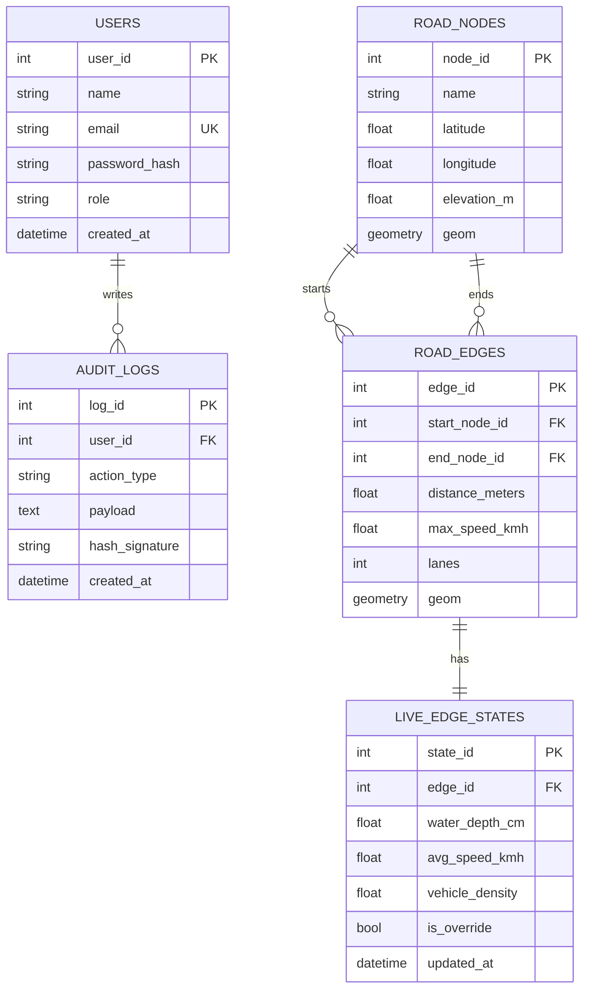

# Technical Specification Document — MetroFlow

| Field             | Value                                                                                  |
| ----------------- | -------------------------------------------------------------------------------------- |
| Document ID       | MF-TSD-001                                                                             |
| Version           | 1.0 (Draft)                                                                            |
| Status            | For academic review                                                                    |
| Date              | 21 October 2026                                                                        |
| Prepared by       | «Project Team»                                                                         |
| Reviewed by       | «Project Adviser»                                                                      |
| Approved by       | «Project Sponsor»                                                                      |
| Related documents | [FSD.md](FSD.md), [api.md](api.md), [PROJ_MANAGEMENT_PLAN.md](PROJ_MANAGEMENT_PLAN.md) |

## Revision history

| Version | Date        | Author         | Change                          |
| ------- | ----------- | -------------- | ------------------------------- |
| 1.0     | 21 Oct 2026 | «Project Team» | Initial technical specification |

## 1. Purpose and scope

This document specifies how MetroFlow is built: architecture, algorithms, data
design, security, deployment and delivery pipeline. It is the construction
counterpart to [FSD.md](FSD.md), which specifies behaviour.

**Baseline:** `main` @ `9605e38`. Statements of fact describe that baseline;
statements marked _Planned_ or _Open_ are not implemented.

## 2. Architecture overview

### 2.1 System context

```
┌──────────────┐        HTTPS/JSON        ┌───────────────────────────┐
│ LGU dispatch │ ───────────────────────► │  MetroFlow API (FastAPI)  │
│ portal       │ ◄─────────────────────── │  simulation + routing     │
│ (Next.js)    │                          └────────────┬──────────────┘
└──────────────┘                                       │ SQLAlchemy
                                                       ▼
┌──────────────┐        HTTPS/JSON        ┌───────────────────────────┐
│ Driver app   │ ───────────────────────► │  PostgreSQL + PostGIS     │
│ (future)     │                          │  nodes · edges · state    │
└──────────────┘                          │  users · audit logs       │
                                          └───────────────────────────┘
┌──────────────┐                           ┌──────────────────────────┐
│ Operator     │  manual rainfall input    │  GitHub Actions          │
│              │ ───────────────────────►  │  test · scan · migrate   │
└──────────────┘                           └──────────────────────────┘
```

### 2.2 Containers

| Container        | Technology                                                              | Responsibility                             | State             |
| ---------------- | ----------------------------------------------------------------------- | ------------------------------------------ | ----------------- |
| API engine       | FastAPI on Python 3.14, Uvicorn                                         | Network state, simulation, routing, health | Stateless         |
| Dispatch portal  | Next.js 16 App Router, React 19                                         | Login, queue, detail, actions              | Client state only |
| Spatial database | PostgreSQL 15 + PostGIS 3.3 (local), PostgreSQL 17 + PostGIS (Supabase) | Road graph, live state, users, audit       | System of record  |
| Cache / broker   | Redis 7                                                                 | Provisioned for caching and pub/sub        | **Unused today**  |

The API is stateless: every request loads its data from PostgreSQL, so instances
can be added horizontally (NFR-15).

### 2.3 Design principles

| Principle                           | Consequence                                                                                                      |
| ----------------------------------- | ---------------------------------------------------------------------------------------------------------------- |
| One source of truth for passability | A single function classifies edges for both map colour and routing, so the legend and the router cannot disagree |
| Configuration over constants        | Calibration values are environment-driven, not literals                                                          |
| Schema owned by migrations          | No `create_all` at runtime; drift fails CI                                                                       |
| Fail closed at the edges            | Security scan and migration gates block rather than warn                                                         |
| Honest boundaries                   | Mock data and unimplemented features are labelled, not implied                                                   |

## 3. Technology stack

| Layer            | Technology                     | Version                             | Why                                                      |
| ---------------- | ------------------------------ | ----------------------------------- | -------------------------------------------------------- |
| Language (API)   | Python                         | 3.14                                | Current stable in CI; typed, mature geospatial ecosystem |
| API framework    | FastAPI                        | ≥ 0.143.5                           | Pydantic validation, OpenAPI generation, async-ready     |
| ORM              | SQLAlchemy                     | ≥ 2.1.5                             | Mature, typed, supports GeoAlchemy2                      |
| Spatial ORM      | GeoAlchemy2                    | ≥ 0.20.0                            | PostGIS geometry columns                                 |
| Migrations       | Alembic                        | ≥ 1.20.0                            | Versioned schema, downgrade path                         |
| Database         | PostgreSQL + PostGIS           | 15 + 3.3 local; 17 + PostGIS hosted | Spatial indexes and geometry functions                   |
| Driver           | psycopg2-binary                | ≥ 2.9.13                            | Synchronous, simple under Uvicorn workers                |
| Settings         | pydantic-settings              | ≥ 2.16.0                            | Environment-driven configuration                         |
| Numerics         | NumPy, SciPy                   | ≥ 2.5.4, ≥ 1.18.1                   | Available for future calibration work                    |
| Frontend         | Next.js                        | 16.4.2                              | App Router, server/client split, typed routes            |
| UI runtime       | React                          | 19.3.1                              | Component model                                          |
| Styling          | Tailwind CSS                   | 4.x                                 | Theme tokens, no runtime CSS-in-JS                       |
| Icons            | lucide-react                   | 1.x                                 | Tree-shaken SVG icons                                    |
| Maps (installed) | MapLibre GL                    | 6.15                                | GeoJSON rendering in a future map view                   |
| Package manager  | Bun                            | 1.4.3                               | Faster installs; lockfile understood by Dependabot       |
| Web tests        | ESLint, Prettier, `next build` | 10.x / 3.9 / 16.4                   | Lint, format, type-check                                 |
| API tests        | pytest                         | see `requirements-dev.txt`          | Unit and integration suites                              |

Version pins are lower bounds in `requirements.txt` and exact for the web app in
`package.json`; CI installs from those and from `bun.lock`.

## 4. Runtime and deployment topology

### 4.1 Local stack

`docker-compose.yml` defines three services:

| Service    | Image / build                   | Port | Health check         |
| ---------- | ------------------------------- | ---- | -------------------- |
| `postgres` | `postgis/postgis:15-3.3-alpine` | 5432 | `pg_isready`         |
| `redis`    | `redis:7-alpine`                | 6379 | `redis-cli ping`     |
| `backend`  | built from `backend/Dockerfile` | 8000 | `curl /openapi.json` |

The backend depends on both services being healthy. The compose stack exists so
CI can bring up the whole system with one command; day-to-day backend work can
run `uvicorn --reload` on the host instead.

> Do not run the host Uvicorn and the compose backend at the same time: both bind
> port 8000.

### 4.2 Container image

`backend/Dockerfile`:

1. `python:3.14-slim` base.
2. Dependencies installed before application code, so edits do not invalidate the
   dependency layer.
3. Runs as unprivileged `appuser` (uid 10001).
4. `HEALTHCHECK` against `/`.
5. `ENTRYPOINT` is `entrypoint.sh`, which applies migrations then `exec`s the
   server.

Migration on start is controlled by `RUN_MIGRATIONS` (default `true`). In a
multi-replica deployment migrations must run once as a separate job; the Supabase
workflow does exactly that for the hosted database.

### 4.3 Hosted database

| Property              | Value                                                                  |
| --------------------- | ---------------------------------------------------------------------- |
| Provider              | Supabase                                                               |
| Project               | MetroFlow                                                              |
| Region                | `ap-northeast-2` (Seoul)                                               |
| Engine                | PostgreSQL 17.11 with PostGIS                                          |
| Connection used by CI | Session pooler, TLS required                                           |
| Access model          | API connects as the table owner; `anon` and `authenticated` are denied |

The direct `db.<ref>.supabase.co` host is IPv6-only and unreachable from GitHub's
IPv4 runners, so the session pooler host is required. The exact pooler prefix
(`aws-0-…` or `aws-1-…`) must be copied from the dashboard.

### 4.4 Application hosting

No hosting target is selected. `Backend Image` publishes an OCI image to GHCR on
a `backend-v*` tag or manual dispatch; a deploy job is added when a host is
chosen. The web app is compatible with any Node/Bun host.

## 5. Component design

### 5.1 API layer (`backend/main.py`)

| Unit                   | Responsibility                                                                        |
| ---------------------- | ------------------------------------------------------------------------------------- |
| `lifespan`             | Seed the demonstration graph on first boot, backfill geometry, release the connection |
| `add_security_headers` | Attach baseline security headers to every response                                    |
| `_load_graph`          | Three fixed queries for nodes, edges and live state (no N+1)                          |
| `_load_edge_geometry`  | Fetch all edge geometry as parsed GeoJSON in one query                                |
| `_build_network_state` | Assemble the GeoJSON response for one clearance profile                               |
| `seed_database`        | Idempotent first-boot seed of the pilot corridor                                      |
| `_require_node`        | 404 with the available node ids                                                       |

Dependency injection uses `Depends(get_db)`; the session is closed in `finally`
so a failed request cannot leak a connection.

### 5.2 Hydrology (`backend/hydrology.py`)

| Function                   | Input                                      | Output              |
| -------------------------- | ------------------------------------------ | ------------------- |
| `calculate_scs_cn_runoff`  | rainfall intensity, curve number, duration | runoff depth in mm  |
| `compute_node_water_depth` | runoff, elevation, amplification           | ponding depth in cm |

### 5.3 Routing (`backend/routing.py`)

| Function               | Responsibility                                                      |
| ---------------------- | ------------------------------------------------------------------- |
| `classify_passability` | Single source of truth for `PASSABLE` / `LIGHT_FLOOD` / `SUBMERGED` |
| `td_a_star_search`     | Time-dependent A\* with flood penalty and clearance blocking        |

### 5.4 Geometry (`backend/geometry.py`)

| Concern               | Approach                                                             |
| --------------------- | -------------------------------------------------------------------- |
| Missing node geometry | `ST_MakePoint(longitude, latitude)` in SRID 4326                     |
| Missing edge geometry | `ST_MakeLine` between endpoint geometries                            |
| Concurrency           | Transaction-scoped advisory lock (`842317`)                          |
| Idempotency           | Only `NULL` rows are updated; existing geometry is never overwritten |
| Indexes               | `GIST` indexes created if absent                                     |

### 5.5 Dispatch portal (`web-lgu/`)

| Unit                             | Responsibility                                            |
| -------------------------------- | --------------------------------------------------------- |
| `app/page.tsx`                   | Renders the portal shell                                  |
| `app/layout.tsx`                 | Font, metadata, global surface                            |
| `components/portal.tsx`          | Screen state, sign-in transition, sign-out                |
| `components/login-screen.tsx`    | Credentials form, reveal toggle, recovery guidance        |
| `components/dashboard.tsx`       | KPI row, queue state, selection, dismissal, logs, actions |
| `components/incident-queue.tsx`  | Ordering, filters, search, counts, empty state            |
| `components/incident-detail.tsx` | Docket, evidence, telemetry, log, note composer, actions  |
| `components/sidebar.tsx`         | Navigation, alert level, unit block, sign-out             |
| `components/toast-provider.tsx`  | Transient confirmations with a single timer               |
| `lib/incidents.ts`               | Mock incident records and initial log entries             |
| `lib/cn.ts`                      | Class merge helper                                        |

State lives in `dashboard.tsx` and flows down as props; there is no global store.
The only shared context is the toast provider.

**Data boundary:** `lib/incidents.ts` is the seam. Replacing it with a fetch
layer is the planned integration point (FSD FR-31, FR-44).

## 6. Algorithms and data structures

### 6.1 SCS Curve Number runoff

```
P  = rainfall_mm_hr × duration_hrs
S  = (25400 / CN) − 254
Ia = 0.2 × S
Q  = (P − Ia)² / (P − Ia + S)     if P > Ia, else 0
```

| Parameter      | Default | Meaning                           |
| -------------- | ------- | --------------------------------- |
| `CN`           | 85      | Urban concrete/asphalt catchment  |
| `duration_hrs` | 1.0     | Converts intensity to storm depth |
| `Ia`           | 0.2 S   | Initial abstraction               |

### 6.2 Ponding depth

```
depression = 1 + (10 − min(elevation_m, 10)) × 0.15
depth_cm   = max(0, (Q / 10) × depression × amplification)
```

| Parameter       | Default                 | Meaning                                                                            |
| --------------- | ----------------------- | ---------------------------------------------------------------------------------- |
| `amplification` | 3.5                     | Calibration coefficient standing in for depression storage and drainage-area ratio |
| `elevation_m`   | upstream node elevation | Lower ground ponds deeper, clamped at a 10 m datum                                 |

The amplification coefficient is deliberately configuration, not a physical
constant. It must be replaced by a DEM and drainage-network model before results
are treated as predictive.

### 6.3 Passability

```
if depth >= clearance      → SUBMERGED
else if depth >= caution   → LIGHT_FLOOD
else                       → PASSABLE
```

Both comparisons are inclusive. `clearance` defaults to 30 cm; `caution` to
10 cm. The same function feeds the map legend and the router's blocking rule.

### 6.4 Time-dependent A\*

**Cost of traversing an edge**

```
penalty     = 1 + (depth_cm / 10)^1.8
speed_m_s   = max((max_speed_kmh / 3.6) / penalty, 0.5)
cost        = length_m / speed_m_s            (seconds)
```

**Blocking rule:** an edge is skipped entirely when `depth_cm >= clearance_cm`.

**Heuristic**

```
h(n) = haversine(n, target) / max_graph_speed_m_s
```

Dividing by the fastest speed in the graph guarantees the heuristic never
overestimates remaining time, so the search is admissible and the result optimal
under the cost function.

**Data structures**

| Structure                          | Use                                                                     |
| ---------------------------------- | ----------------------------------------------------------------------- |
| `heapq` min-heap of `(f, g, node)` | Frontier; entries carry their own `g` so stale duplicates are discarded |
| `g_score` dict                     | Best known cost per node                                                |
| `came_from` dict                   | Path reconstruction                                                     |
| `settled` set                      | Guarantees each node expands once                                       |

**Complexity:** `O(E log V)` time, `O(V + E)` space.

**Bidirectional treatment:** each edge is added in both directions, so a reverse
trip never returns 404.

### 6.5 Geometry assembly

For each hop, stored geometry is fetched and reversed when travel runs against
the stored direction. Consecutive hops are joined, dropping a duplicated vertex
at the seam. A straight line is used when geometry is missing.

## 7. Data design

### 7.1 Entity relationships



### 7.2 `road_nodes`

| Column        | Type                  | Null | Notes                         |
| ------------- | --------------------- | ---- | ----------------------------- |
| `node_id`     | integer               | no   | Primary key                   |
| `name`        | varchar(100)          | yes  | Human label                   |
| `latitude`    | double                | no   | WGS84 latitude                |
| `longitude`   | double                | no   | WGS84 longitude               |
| `elevation_m` | double                | yes  | Default 10.0; drives ponding  |
| `geom`        | geometry(Point, 4326) | yes  | Backfilled, never overwritten |

Index: primary key, GiST on `geom`.

### 7.3 `road_edges`

| Column            | Type                       | Null | Notes                     |
| ----------------- | -------------------------- | ---- | ------------------------- |
| `edge_id`         | integer                    | no   | Primary key               |
| `start_node_id`   | integer                    | no   | FK → `road_nodes.node_id` |
| `end_node_id`     | integer                    | no   | FK → `road_nodes.node_id` |
| `distance_meters` | double                     | no   | Traversal length          |
| `max_speed_kmh`   | double                     | yes  | Default 50                |
| `lanes`           | integer                    | yes  | Default 2                 |
| `geom`            | geometry(LineString, 4326) | yes  | Backfilled from endpoints |

Index: primary key, GiST on `geom`.

### 7.4 `live_edge_states`

| Column            | Type      | Null | Notes                               |
| ----------------- | --------- | ---- | ----------------------------------- |
| `state_id`        | integer   | no   | Primary key                         |
| `edge_id`         | integer   | no   | Unique FK → `road_edges.edge_id`    |
| `water_depth_cm`  | double    | yes  | Current depth                       |
| `avg_speed_kmh`   | double    | yes  | Degraded by simulation              |
| `vehicle_density` | double    | yes  | Reserved                            |
| `is_override`     | boolean   | yes  | Manual overrides survive simulation |
| `updated_at`      | timestamp | yes  | Set on insert and update            |

### 7.5 `users` and `audit_logs`

| Table        | Purpose                                        | Status                     |
| ------------ | ---------------------------------------------- | -------------------------- |
| `users`      | Account, role, password hash                   | Schema only; no auth flow  |
| `audit_logs` | Actor, action, JSON payload, SHA-256 signature | Schema only; no write path |

Roles stored as strings: `SUPER_ADMIN`, `LGU_DISPATCHER`,
`EMERGENCY_DRIVER`.

### 7.6 Migrations

| Revision       | Purpose                                                            |
| -------------- | ------------------------------------------------------------------ |
| `fd26e0cb82cc` | Initial schema: five application tables plus spatial columns       |
| `a1b2c3d4e5f6` | Enable RLS on application tables and revoke `anon`/`authenticated` |

Rules:

- Every schema change is a revision; `create_all` is never called at runtime.
- CI runs `alembic upgrade head` then `alembic check`; drift fails the build.
- Reflected foreign tables (PostGIS `spatial_ref_sys`, `tiger`, `topology`) are
  filtered out of autogenerate. Consequence: deleting a model does not
  auto-generate a `DROP`; that must be written by hand.
- Downgrades are maintained so a revision can be reversed during development.

## 8. API design

| Method | Path                       | Handler                       | Response model         |
| ------ | -------------------------- | ----------------------------- | ---------------------- |
| GET    | `/`                        | `root`                        | Ad-hoc JSON            |
| GET    | `/api/v1/network/state`    | `get_network_state`           | `NetworkStateResponse` |
| POST   | `/api/v1/simulation/rain`  | `trigger_rainfall_simulation` | `SimulationResponse`   |
| GET    | `/api/v1/routing/navigate` | `get_optimal_route`           | `RouteResponse`        |

Design choices:

| Choice                                                  | Rationale                                                                       |
| ------------------------------------------------------- | ------------------------------------------------------------------------------- |
| Simulation is `POST` although it takes query parameters | It mutates live state; `POST` prevents a crawler or prefetch from triggering it |
| Simulation returns the full network                     | Avoids a second round trip for the map                                          |
| GeoJSON as the wire format                              | Directly consumable by MapLibre and GIS tooling                                 |
| Errors as HTTP status plus `detail`                     | FastAPI default; 404 carries actionable text (available node ids)               |
| No versioning beyond `/api/v1`                          | One public version; breaking changes get `/api/v2`                              |

The generated OpenAPI document at `/openapi.json` is the machine-readable
contract and is what the ZAP scan consumes. Human-readable contracts, examples
and error cases are in [api.md](api.md).

## 9. Security design

### 9.1 Controls in place

| Layer            | Control                                                                                                                     |
| ---------------- | --------------------------------------------------------------------------------------------------------------------------- |
| Transport        | TLS terminated by the host/pooler; CI requires `sslmode=require`                                                            |
| Response headers | `X-Content-Type-Options: nosniff`, `Cross-Origin-Resource-Policy: cross-origin`, `Referrer-Policy`, `X-Frame-Options: DENY` |
| Database access  | RLS enabled on all application tables; `anon` and `authenticated` revoked                                                   |
| Migrations       | `alembic_version` also protected so the Data API cannot rewrite history                                                     |
| Container        | Non-root user, no build tooling in the runtime layer                                                                        |
| Secrets          | Environment variables and repository secrets only; `.env` ignored                                                           |
| Dependencies     | Dependabot with grouped weekly updates; TypeScript major pinned                                                             |
| Static analysis  | CodeQL workflow with a preflight capability probe                                                                           |
| Dynamic analysis | OWASP ZAP API scan against the live stack, weekly, fail-closed                                                              |
| Repository token | Workflows declare `contents: read`                                                                                          |

### 9.2 Row-level security

Supabase exposes the `public` schema through PostgREST. Its default privileges
would let the public `anon` key read and write application tables — including
`users.password_hash`. The RLS migration therefore:

1. Enables RLS on every application table with **no policies**, which denies
   every non-owner request.
2. Revokes all privileges from `anon` and `authenticated` where those roles
   exist, as defence in depth.
3. Leaves the owner role (`postgres`) unaffected, because owners bypass RLS
   unless `FORCE ROW LEVEL SECURITY` is set — and it deliberately is not.

Verified by connecting as `anon` and observing `permission denied for table
users`.

### 9.3 Open risks

| ID     | Risk                                         | Severity | Disposition                                                                |
| ------ | -------------------------------------------- | -------- | -------------------------------------------------------------------------- |
| SEC-01 | API has no authentication or authorisation   | High     | Accepted for the pilot; BR-09 is the first post-pilot increment            |
| SEC-02 | CORS allows every origin with credentials    | Medium   | Restrict to known portal origins before production                         |
| SEC-03 | No rate limiting                             | Medium   | Add at the proxy or via middleware before public exposure                  |
| SEC-04 | CodeQL cannot analyse the private repository | Medium   | Workflow auto-enables when the repo is public or Code Security is licensed |
| SEC-05 | No secret scanning beyond GitHub defaults    | Low      | Enable push protection                                                     |
| SEC-06 | Audit hash is a column without a write path  | Low      | Implement with FR-47                                                       |

`SEC-01` is the reason the pilot may not handle real personal data. That
constraint is stated in the BRD and must appear in the final report.

## 10. Performance and capacity

| Operation     | Complexity   | Dominant cost                         |
| ------------- | ------------ | ------------------------------------- |
| Network state | `O(V + E)`   | Four queries plus geometry JSON parse |
| Simulation    | `O(V + E)`   | Per-edge arithmetic plus one commit   |
| Routing       | `O(E log V)` | Heap operations                       |

| Aspect           | Current position                                                                                                               |
| ---------------- | ------------------------------------------------------------------------------------------------------------------------------ |
| Pilot graph      | 4 nodes, 4 edges (demonstration corridor)                                                                                      |
| Database indexes | Primary keys plus GiST on geometry                                                                                             |
| Connection model | One session per request, synchronous driver                                                                                    |
| Caching          | None; Redis is provisioned but unused                                                                                          |
| Expected limit   | Thousands of edges are fine for `O(E log V)`; the bottleneck becomes per-request geometry serialisation                        |
| Scaling path     | Add API replicas behind a load balancer; cache network state per clearance; move geometry serialisation to a materialised view |

NFR-01 and NFR-02 are targets, not measured results. A load test is listed in
the PMP quality plan.

## 11. Reliability and error handling

| Failure                          | Behaviour                                                                |
| -------------------------------- | ------------------------------------------------------------------------ |
| Database unreachable at startup  | Lifespan raises; container exits; health check never goes green          |
| Unknown node id                  | 404 naming the available ids                                             |
| No safe route                    | 404 with a human-readable message, never an empty 200                    |
| Invalid parameter                | 422 with field detail from Pydantic                                      |
| Simulation on an overridden edge | Edge skipped; not counted as affected                                    |
| Concurrent geometry backfill     | Serialised by a transaction-scoped advisory lock                         |
| Interrupted migration            | Transaction rolls back; the CD workflow does not cancel an in-flight run |
| Duplicate seeding on restart     | Seed returns early when nodes exist                                      |

Transaction boundaries:

- Read endpoints do not commit.
- Simulation commits once, after all edge updates, so a partial update cannot be
  observed.
- Migrations run in a single transaction per revision.

## 12. Observability

| Signal             | Current state                                | Gap                                     |
| ------------------ | -------------------------------------------- | --------------------------------------- |
| Health endpoint    | `/` returns status and identity              | No dependency checks (database, pooler) |
| Container health   | Docker `HEALTHCHECK` on `/`                  | Does not prove database connectivity    |
| Startup log        | Geometry backfill counts                     | No structured logging                   |
| CI evidence        | Workflow logs, ZAP artifacts, step summaries | No metrics retention                    |
| Application errors | Uvicorn default output                       | No error tracker, no correlation ids    |
| Database           | Supabase dashboard                           | No alerting configured                  |
| Uptime             | None                                         | No external monitor                     |

For the pilot, CI artifacts and container health are the evidence base. Before
production, add structured logs with request ids, an uptime check on `/openapi.json`,
and alerts on migration failure.

## 13. Testing strategy

| Layer              | Tool                                           | Scope                                                                                                 | Gate                            |
| ------------------ | ---------------------------------------------- | ----------------------------------------------------------------------------------------------------- | ------------------------------- |
| Unit               | pytest (`-m "not integration"`)                | Hydrology monotonicity, SCS-CN edge cases, passability thresholds, A\* optimality, no-route behaviour | Backend CI `Unit tests`         |
| Contract           | pytest (`-m integration`) against real PostGIS | Every endpoint, status codes, response shape, security headers                                        | Backend CI `API contract tests` |
| Schema             | Alembic                                        | `upgrade head` on a clean database, then `check` for drift                                            | Backend CI                      |
| Static (web)       | ESLint                                         | Correctness and framework rules                                                                       | Web CI `Lint and build`         |
| Type               | TypeScript via `next build`                    | Type errors block the build                                                                           | Web CI                          |
| Build              | Next.js production build                       | Route compiles and prerenders                                                                         | Web CI                          |
| Security (dynamic) | OWASP ZAP API scan                             | Live stack, OpenAPI-driven                                                                            | Weekly workflow, fail-closed    |
| Security (static)  | CodeQL                                         | Python and TypeScript                                                                                 | Skipped while unlicensed        |
| Migration delivery | Alembic to Supabase                            | Hosted schema at head                                                                                 | Gated CD workflow               |
| Exploratory        | Manual browser session                         | Login → triage → dispatch → sign-out                                                                  | Demonstration                   |

The integration suite runs against a real database on purpose: mocking PostGIS
would not prove that the geometry queries or the migrations work.

**Not automated:** browser end-to-end tests. The portal was verified with a
scripted Playwright session during development, but that script is not committed.
Adding it to Web CI is a recommended improvement.

## 14. CI/CD pipeline

### 14.1 Workflows

| Workflow                          | Trigger                                                    | What it does                                                                                                                        | Gate behaviour                                                                     |
| --------------------------------- | ---------------------------------------------------------- | ----------------------------------------------------------------------------------------------------------------------------------- | ---------------------------------------------------------------------------------- |
| **Backend CI**                    | Push/PR touching `backend/**` or its workflow; manual      | `Unit tests` job; `API contract tests` job with PostGIS and Redis services, `alembic upgrade head`, `alembic check`, contract tests | Blocks merge: both jobs must pass                                                  |
| **Web CI**                        | Push/PR touching `web-lgu/**` or its workflow; manual      | Bun install from lockfile, ESLint, `next build` (includes type check)                                                               | Blocks merge                                                                       |
| **Security — OWASP ZAP API Scan** | Weekly cron (Mon 10:00 PHT) and manual                     | `docker compose up` the real stack, wait for `/openapi.json`, run `zap-api-scan.py`, publish HTML/MD/JSON artifacts                 | **Fails the run** on findings at or above threshold; no `continue-on-error`        |
| **Security — CodeQL**             | Push/PR to `main`, weekly, manual                          | Preflight probes code-scanning availability; analyses Python and TypeScript with `security-extended` when available                 | Skips with a visible warning on private repos without Code Security                |
| **Supabase — Apply migrations**   | `workflow_run` after Backend CI succeeds on `main`; manual | Applies Alembic history to the hosted database, then confirms the current revision                                                  | No-ops with a notice when `SUPABASE_DB_URL` is absent; serialised, never cancelled |
| **Backend Image**                 | Manual, or `backend-v*` tag                                | Builds the container and pushes to GHCR with branch, semver and SHA tags                                                            | Does not deploy; no host selected                                                  |

### 14.2 Delivery flow

```
change ──► pull request ──► Backend CI ──┐
                       └──► Web CI     ──┴──► merge to main
                                              │
                                              ├──► Backend CI (main) ──► Supabase migrations
                                              │
                                              └──► tag backend-v* ──► GHCR image ──► (deploy job: not yet)
```

### 14.3 Why migrations are a separate workflow

Schema changes must not compete with application startup when several API
replicas exist. Backend CI validates revisions against an ephemeral PostGIS
container; the Supabase workflow ships only history that already passed. The
workflow is serialised and does not cancel in progress, because interrupting DDL
midway is worse than waiting.

## 15. Environments and configuration

### 15.1 Environments

| Environment | Database                             | Purpose                        | Lifetime             |
| ----------- | ------------------------------------ | ------------------------------ | -------------------- |
| Local       | Compose PostGIS on 5432              | Development                    | Developer-controlled |
| CI          | Service container, recreated per run | Tests and scans                | Job lifetime         |
| Hosted      | Supabase project, Seoul              | Deployment target for schema   | Persistent           |
| Production  | None selected                        | Runtime for the API and portal | —                    |

### 15.2 Configuration

Application settings use the `METROFLOW_` prefix and may also be supplied in a
local `.env`:

| Variable                          | Default           | Effect                                            |
| --------------------------------- | ----------------- | ------------------------------------------------- |
| `DATABASE_URL`                    | local PostGIS DSN | Connection string (no prefix; read directly)      |
| `METROFLOW_CURVE_NUMBER`          | 85                | SCS-CN curve number                               |
| `METROFLOW_RAINFALL_DURATION_HRS` | 1.0               | Storm duration for intensity to depth             |
| `METROFLOW_PONDING_AMPLIFICATION` | 3.5               | Runoff-to-street-depth calibration                |
| `METROFLOW_CAUTION_DEPTH_CM`      | 10.0              | Light-flood threshold                             |
| `METROFLOW_DEFAULT_CLEARANCE_CM`  | 30.0              | Clearance when the client omits it                |
| `RUN_MIGRATIONS`                  | true              | Whether the container applies migrations on start |

Repository secrets:

| Secret            | Required by                 | Status                             |
| ----------------- | --------------------------- | ---------------------------------- |
| `SUPABASE_DB_URL` | Supabase migration workflow | **Not set**; CD no-ops until it is |

`GITHUB_TOKEN` is provided automatically and used for GHCR login.

## 16. Architecture decisions

| ID     | Decision                                            | Alternatives considered                     | Rationale                                                                                                              | Status                |
| ------ | --------------------------------------------------- | ------------------------------------------- | ---------------------------------------------------------------------------------------------------------------------- | --------------------- |
| ADR-01 | Alembic owns the schema; no `create_all` at runtime | `Base.metadata.create_all`                  | `create_all` creates missing tables but never alters existing ones, so the database would drift from migration history | Accepted              |
| ADR-02 | Hosted Postgres is Supabase                         | Self-managed VM, RDS                        | Managed PostGIS, free tier, pooler for IPv4 CI, point-in-time recovery on paid plans                                   | Accepted              |
| ADR-03 | Session pooler connection for CI                    | Direct `db.<ref>` host                      | Direct host is IPv6-only; GitHub runners are IPv4                                                                      | Accepted              |
| ADR-04 | Time-dependent A\* rather than Dijkstra             | Dijkstra, contraction hierarchies           | Heuristic gives optimal routes with a smaller frontier; flood penalty makes cost time-dependent anyway                 | Accepted              |
| ADR-05 | SCS-CN for runoff                                   | Rational method, full hydrodynamic model    | Standard, explainable, few parameters; adequate for a decision aid                                                     | Accepted, replaceable |
| ADR-06 | Ponding amplification as configuration              | Hard-coded coefficient                      | Makes the calibration assumption explicit and tunable                                                                  | Accepted              |
| ADR-07 | RLS deny-by-default on Supabase                     | Rely on API auth only                       | The Data API is publicly reachable with the anon key; RLS is the last line of defence                                  | Accepted              |
| ADR-08 | ZAP is a gate, not a report                         | `continue-on-error`                         | A report nobody reads does not prevent regressions                                                                     | Accepted              |
| ADR-09 | CodeQL preflight skip                               | Delete the workflow, or let it fail         | Keeps the workflow ready to activate without edits, and keeps `main` green                                             | Accepted              |
| ADR-10 | Bun ecosystem in Dependabot                         | npm ecosystem                               | Dependabot cannot parse `bun.lock` under npm                                                                           | Accepted              |
| ADR-11 | Portal ships with mock incident data                | Block the UI until the incidents API exists | Demonstrates the workflow and fixes the visual contract early; the seam is one module                                  | Accepted, interim     |
| ADR-12 | Security headers in middleware                      | Reverse proxy only                          | Guarantees the headers exist even when the app runs without a proxy, which is how ZAP sees it                          | Accepted              |
| ADR-13 | Redis provisioned but unused                        | Remove it                                   | The compose stack keeps parity with the intended production topology; removing and re-adding causes churn              | Open                  |

## 17. Known limitations and technical debt

| ID     | Limitation                                     | Impact                                        | Planned resolution                                          |
| ------ | ---------------------------------------------- | --------------------------------------------- | ----------------------------------------------------------- |
| LIM-01 | No authentication or authorisation             | Cannot handle real personal data; API is open | Implement identity and roles (BR-09)                        |
| LIM-02 | Incident data is mocked in the portal          | Triage is demonstrated, not operational       | Build incident intake and persistence                       |
| LIM-03 | No live sensor or weather ingestion            | Simulation is operator-driven                 | Integrate feeds with data-sharing agreements                |
| LIM-04 | Redis is unused                                | Extra container in the stack                  | Add caching for network state and pub/sub for updates       |
| LIM-05 | CORS allows all origins with credentials       | Cross-origin abuse surface                    | Allowlist portal origins                                    |
| LIM-06 | No rate limiting or WAF                        | DoS and credential-stuffing exposure          | Proxy-level rules before public exposure                    |
| LIM-07 | No map rendering in the portal                 | GeoJSON is served but not drawn               | MapLibre component consuming the network endpoint           |
| LIM-08 | Audit log is schema-only                       | No immutable trail of decisions               | Implement FR-47 with hash chaining                          |
| LIM-09 | No automated browser end-to-end tests          | Regressions in the UI caught manually         | Add Playwright to Web CI                                    |
| LIM-10 | CodeQL inactive on the private repo            | Static analysis gap                           | Publish the repo or license Code Security                   |
| LIM-11 | Single-region hosted database                  | Latency and availability risk                 | Choose a region near operations; add read replica if needed |
| LIM-12 | No backup/restore runbook or DR test           | Recovery objectives unverified                | Define RPO/RTO and test restore                             |
| LIM-13 | Deleting a model does not auto-generate `DROP` | Manual migration required                     | Documented in migrations guidance                           |
| LIM-14 | Seeded graph is four nodes                     | Routing demonstration is narrow               | Import real road network and elevation                      |

## 18. Traceability to the FSD

| FSD module                   | Requirements | TSD sections             |
| ---------------------------- | ------------ | ------------------------ |
| A — Network state            | FR-01–FR-05  | §5.1, §6.3, §7, §8       |
| B — Rainfall simulation      | FR-06–FR-10  | §5.1, §5.2, §6.1, §6.2   |
| C — Routing                  | FR-11–FR-17  | §5.3, §6.4, §6.5         |
| D — Portal access            | FR-18–FR-23  | §5.5 (LIM-01)            |
| E — Incident queue           | FR-24–FR-31  | §5.5, §7 (mock boundary) |
| F — Incident detail          | FR-32–FR-38  | §5.5                     |
| G — Dispatch actions         | FR-39–FR-46  | §5.5, §17 (LIM-08)       |
| H — Audit and administration | FR-47–FR-49  | §7.5, §17 (LIM-08)       |
| I — Operations               | FR-50–FR-53  | §4, §5.1, §14            |

## 19. Appendix — repository and commands

### 19.1 Layout

```
MetroFlow/
├── backend/                 FastAPI engine
│   ├── main.py              app, middleware, endpoints
│   ├── config.py            METROFLOW_* settings
│   ├── hydrology.py         SCS-CN and ponding
│   ├── routing.py           passability and TD-A*
│   ├── geometry.py          PostGIS backfill
│   ├── models.py            SQLAlchemy models
│   ├── schemas.py           response contracts
│   ├── migrations/          Alembic history
│   ├── tests/               unit and integration suites
│   ├── Dockerfile
│   └── entrypoint.sh
├── web-lgu/                 Next.js dispatch portal
│   ├── app/                 routes, layout, theme
│   ├── components/          portal screens and panels
│   └── lib/                 mock data and helpers
├── docs/                    this document set
├── scripts/                 pre-commit helper
├── .github/workflows/       CI/CD
└── docker-compose.yml       local stack
```

### 19.2 Commands

| Task                 | Command                                     |
| -------------------- | ------------------------------------------- |
| Start the full stack | `docker compose up --build`                 |
| Run the API only     | `cd backend && uvicorn main:app --reload`   |
| Apply migrations     | `cd backend && alembic upgrade head`        |
| Check model drift    | `cd backend && alembic check`               |
| Run unit tests       | `cd backend && pytest -m "not integration"` |
| Run contract tests   | `cd backend && pytest -m integration`       |
| Run the portal       | `cd web-lgu && bun run dev`                 |
| Lint the portal      | `cd web-lgu && bun run lint`                |
| Build the portal     | `cd web-lgu && bun run build`               |
| Inspect the contract | `curl http://localhost:8000/openapi.json`   |

### 19.3 References

- FastAPI documentation — <https://fastapi.tiangolo.com>
- PostGIS reference — <https://postgis.net/documentation/>
- SCS Curve Number method — USDA NRCS National Engineering Handbook, Part 630
- A\* search — Hart, Nilsson & Raphael (1968)
- OWASP API Security Top 10 — <https://owasp.org/API-Security/>
- Data Privacy Act of 2012 (RA 10173)
- Philippine Disaster Risk Reduction and Management Act of 2010 (RA 10121)
